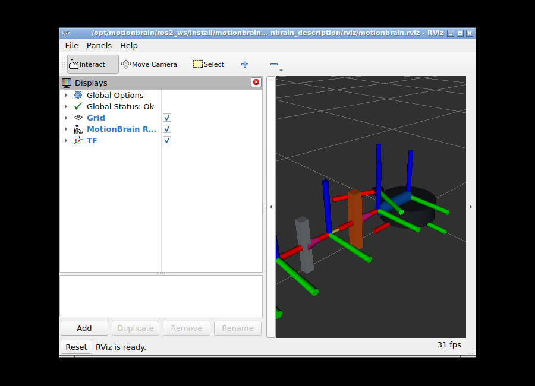

# MotionBrain | Learning the effects of actions on a physical robot arm

[한국어](PORTFOLIO.md) · [Project overview and setup](README.en.md) · [Design and experiment index (Korean)](docs/README.md)

**If the arm takes this action, how will the arm and its surroundings change?** MotionBrain learns these changes from images, available sensor readings and the proposed command. The control objective is to predict the outcomes of candidate actions, choose one that brings the arm closer to a goal, then observe what happened and adjust the next choice. Of the five DC axes, only the shoulder (M4) provides direct angle feedback. That constraint shaped how I designed the firmware output records, camera timing, training labels and criteria for physical success.

I connected the STM32 sensing and teleoperation firmware, ESP32 motor controller, Raspberry Pi ROS2 services and host-side vision and learning tools. The cases below trace the engineering decisions through to their measurements.

## Physical control | Accepting a command and reaching a target

The STM32 reads the IMU and teleoperation buttons and transmits input over UART with a dead-man signal. The ESP32 manages direction, PWM and stopping for five motor axes. Its shoulder controller reads an AS5600 angle sensor over I²C. Because teleoperation and model commands share an output path, the system needs to trace who initiated each action and when the driver turned off. [STM32 firmware](firmware/stm32/MotionBrainSensor/Core/Src/main.c) · [ESP32 wiring and feedback choices](PIN_MAP.en.md) · [Teleoperation video](docs/assets/demo/motionbrain-demo.mp4)

When I requested 234°, the shoulder settled at 235.37° after cutoff, yet the controller reported that it had reached the target. I introduced direction-dependent early cutoff, measured the error after settling, and allowed bounded corrections. A remaining miss returns `TARGET_MISSED`. Two experiments answer different questions about this control path.

| Test | Physical result | Scope |
| --- | --- | --- |
| M4 firmware closed loop | With a fixed mounting, 11/11 targets reached without added load, mean absolute error 0.132°. With 23.10 g, 11/11 and 0.155°. | Settled AS5600 readings over 230–245°. Absolute joint-angle calibration and accuracy on the other axes require separate measurements. [Load-specific runs](docs/evidence/2026-06-28-m4-shoulder-closed-loop.en.md) |
| Physical `ros2_control` | A 250.00° M4 target proposed by `ForwardCommandController` settled at 249.96° with zero corrections and zero commands on other axes. | The operator could confirm a proposal once within 20 s. A second confirmation and a request in IDLE were rejected. [Physical ROS2 test](docs/evidence/2026-07-13-m4-physical-ros2-control.en.md) · [Hardware interface](ros2_ws/src/motionbrain_hardware_interface/README.en.md) |

## Observations and data | Which records can train a model?

The external camera sees the arm and table. The gripper-mounted camera sees the object relative to the jaws. An October teleoperation experiment produced 21 motion requests and 37 images. The asynchronous snapshots could not establish action boundaries, leaving **zero transitions eligible for training** even though the object was visibly lifted. [Manual repetitions and failed attempts (Korean)](docs/evidence/2026-10-17-lipbalm-repetitions.md)

I linked **pre-action observation → proposed command → driver output and cutoff → post-action observation** for each motion. Registration uses the first frame of each recording. The audit checks source hashes, observation-time bounds, controller boot and output history. Requested PWM can differ from the ramp actually delivered by the driver, so recorded outputs serve as execution evidence and labels. An ambiguous HTTP result stops the trial and remains in the record. [Command journal and transport](learning/supervised_transport.py) · [Dataset audit](learning/manual_collection_dataset.py) · [Measured response delays (Korean)](docs/evidence/2026-11-04-http-response-gap.md)

While diagnosing an unresponsive ESP32-CAM, I traced one bug to a socket timeout API that took seconds. A setting intended as 750 ms had become 750 s. I corrected the socket options and verified 20 actual settings. The root cause of the first-boot watchdog reset remained unresolved. [Camera diagnostics and reproduction conditions (Korean)](docs/evidence/2026-10-15-camera-boot-watchdog.md)

I applied the same evaluation discipline to vision. An object-and-gripper detector failed on all four evaluable relative-position cases in six new fixed-camera photographs. After adding those photos to training, it recovered 8/8 object–gripper pairs on the mixed training set, with one duplicate object detection. The retraining images ceased to count as independent evaluation data. [Detection experiment and false-positive analysis (Korean)](docs/evidence/2026-10-30-cv-development.md)

## Action prediction | When do images improve on a simple baseline?

I froze the models before scoring new actions and kept joint, command duration and observation conventions separate.

| Question | Comparison and result | Decision |
| --- | --- | --- |
| Do current images improve prediction of M4 angle change? | Three outputs × two durations, 18 training and 18 fresh evaluation actions. MAE was 2.154° for no change, 0.624° for the overall mean, **0.367°** for the per-command mean, 0.595° for command-only ridge and 0.605° for image-plus-command ridge. | The 8×4 grayscale image failed to beat the per-command mean. I moved on to explicit relative observations of the object, jaws and arm markers. [Conditions and baselines (Korean)](docs/evidence/2026-11-04-m4-action-prediction.md) |
| Can relative state predict the next position on M3? | Trained on 18 actions at 60% for 350 ms. On 11 of 12 new records supported by both methods, mean vector error was **1.074 px**, versus 1.341 px for the command mean. | The evaluation contained only two of the four required downward samples. A conditional supplement also missed completeness, so the original result remains a failed evaluation. [Direction counts and supplement (Korean)](docs/evidence/2026-11-12-m3-goal-prediction.md) |
| Can an M2 prediction guide physical approach? | Split 32 image-direction transitions 16/8/8. Test MAE was **0.665°** versus 6.797° for no change. After one physical command chosen by the frozen model, image-space goal error fell from 5.479° to **0.967°**. | Of four attempts that started recording, the first three stopped before actuation. The one actuated attempt moved toward the target. [Prediction test (Korean)](docs/evidence/2026-10-31-first-action-prediction.md) · [Physical approach (Korean)](docs/evidence/2026-10-31-first-model-goal-approach.md) |

I checked physical progress independently of prediction error. One UP command selected by a separate M3 development model reached the boundary of the image-space tolerance. The first model-selected M1 closure reduced the jaw gap from 126.677 px to 113.767 px, short of its 85.3 px goal. After realignment, a later model-selected closure was followed by a **manual** shoulder lift. [New-view M3 test (Korean)](docs/evidence/2026-11-13-bounded-m3-approach.md) · [M1 closure and manual lift (Korean)](docs/evidence/2026-11-13-model-selected-m1-close.md) · [Earlier lift candidate failures (Korean)](docs/m4-up-commissioning.md)

## Kinematics and simulation | How closely does the model match the arm?

I recorded link dimensions and uncertainties from measurements, assembly drawings and photographs in a common geometry file, then compared FK, IK and whole-arm and M4-only URDF coordinates. The last measured M4 angle can be applied to a virtual pose, with assumed values on the other four axes. A roughly 3° residual in the stationary photograph was retained. [Shared geometry](ros2_ws/src/motionbrain_ros_bridge/motionbrain_ros_bridge/arm_geometry.json) · [Dimensions and calibration conditions (Korean)](docs/arm-calibration.md)

I also measured endpoints in physical recordings. After registration on the first frame of each of two demonstrations, the motion-only prediction on eight additional frames had mean image errors of **1.56 px** at the elbow, **4.72 px** at the wrist and **46.58 px** at the jaw tip. Opening the jaws changes the silhouette endpoint, so link alignment alone does not determine grasp-point accuracy. [Measurement method and errors (Korean)](docs/arm-calibration.md#시연-영상에서-측정한-2차원-오차)

I used RViz to inspect joints and coordinate frames and Gazebo and MuJoCo to check whether the same geometry transferred consistently between engines. Rerun replays the two physical camera views alongside predictions and outputs. W&B reports compare frozen models against baselines. Mass, inertia, actuation delay and jaw contact still require physical calibration. [Replay and validation across the five tools (Korean)](docs/robot-visualization.md)

## Physical action policies | From one action to a sequence

**Choosing within a phase.** In a prepared scene on November 15, the experiment supervisor set each phase and goal. Frozen models compared candidates and stopping at each decision. The last six commands were three closes, one lift, one lower and one open. The cameras showed the object held in observations 3.582 s apart, then back on the table and released. Lowering that day used an inverse-UP hypothesis with zero direct DOWN training records. Seven of eight model-actuated commands completed and one failed. Of 16 separate manual setup and collection commands, 14 completed and two failed. [Denominators, observations and W&B report (Korean)](docs/evidence/2026-11-15-prepared-scene-model-grasp-lift-release.md)

**Finding action boundaries in demonstrations.** The whole-arm manual series reached nine demonstrations. In the first I aligned seven press-and-release actions to video and driver output, grouping 98 keep-alive requests within their original actions. The instant at which the table began supporting the object remained uncertain. An offline behavior-cloning experiment predicted the joint and direction from the two views at the time of a human button press. The deployed policy also used its own phase-transition and stopping logic. [Demonstration collection (Korean)](docs/manual-data-collection.md) · [Recorder](tools/record_controller_ui.py)

**Deployment case.** In whole-arm development trial 5, a person positioned the object and empty arm. Without joint-button input, the arm approached, grasped, lifted, lowered, released and retreated. Visual jaw opening triggered a normal STOP. A fresh camera pair then confirmed release before retreat. The object rose 166 px against a 226.25 px target and stood on the table in the last image. The policy selected retreat termination at 214.98°, short of the 216.65° demonstration lower bound, so the trial failed its original criterion. Final vertical clearance was 1.42 object heights in the image. Stability for three seconds after stopping was unverified. [Physical trial video](docs/assets/whole-arm-cycle.mp4) · [Five development trials and their outcomes (Korean)](docs/whole-arm-cycle.md)

## What remains to be demonstrated

- **Action policies and imitation learning.** Score upright placement, gripper clearance and post-stop stability separately from similarity to a demonstrated pose. Fix the criteria in advance, vary starting poses and object placement, then count successes, failures, stops and human interventions.
- **VLMs and VLAs.** A multimodal rater reviewed 55 camera pairs from one recorded demonstration in eight clips. Its final released-and-standing judgment matched the operator. The next test is state assessment on independent episodes, followed by testing whether different language instructions in the same scene produce the corresponding actions. [Recorded evaluation conditions (Korean)](docs/visual-action-learning.md)
- **Dynamics, sim-to-real and reinforcement learning.** Measure virtual and physical responses to the same commands to calibrate load effects and delay. A policy trained in simulation still needs comparison with the existing physical policy on the same task.

The public repository supports host checks and firmware and ROS2 builds. Reproducing the physical trial and its measurements also requires the corresponding private recordings, models, scene registration and commissioning runner. [Operations](OPERATIONS.en.md) · [Firmware and host CI](https://github.com/ParkJsoo/motionbrain/actions/workflows/platformio.yml) · [ROS2 CI](https://github.com/ParkJsoo/motionbrain/actions/workflows/ros2.yml)
