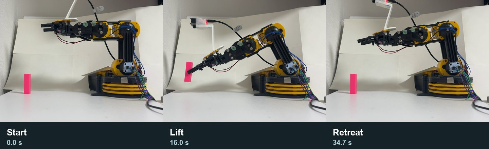
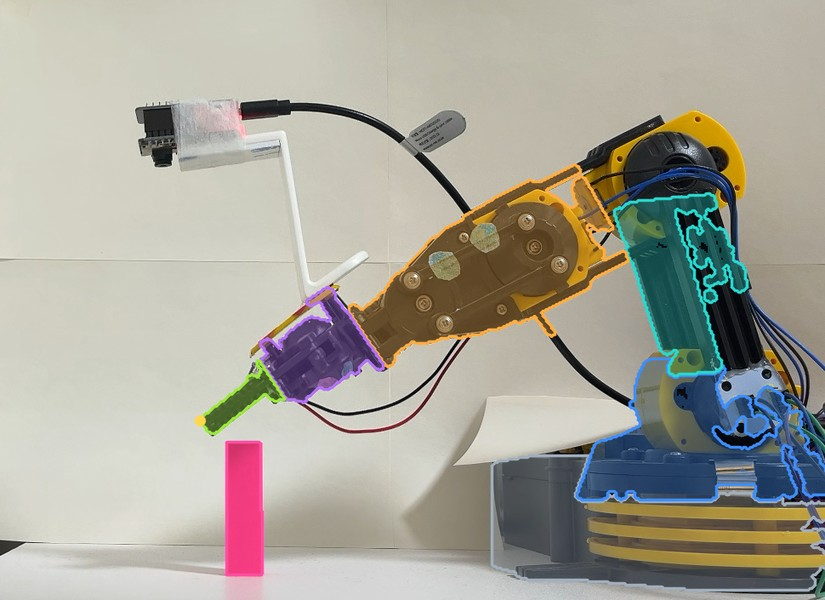
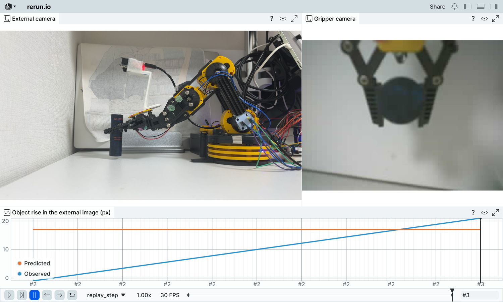
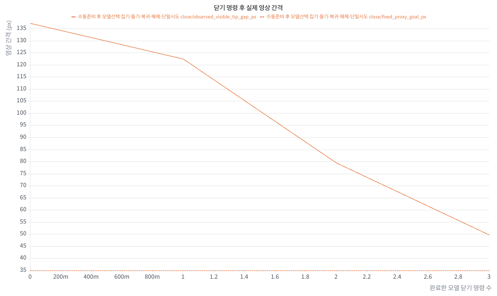
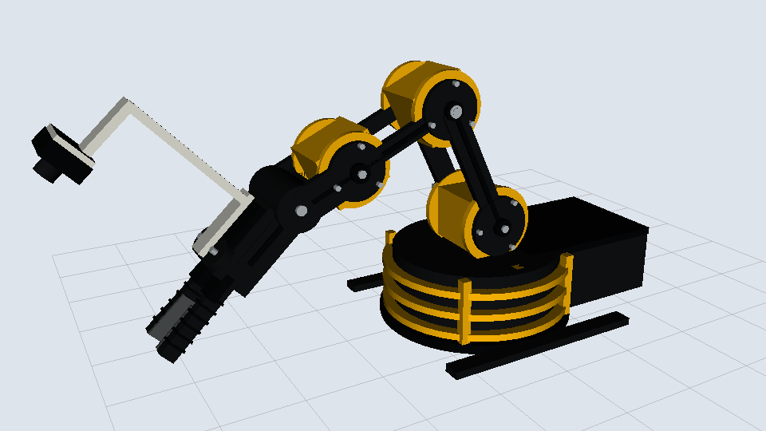
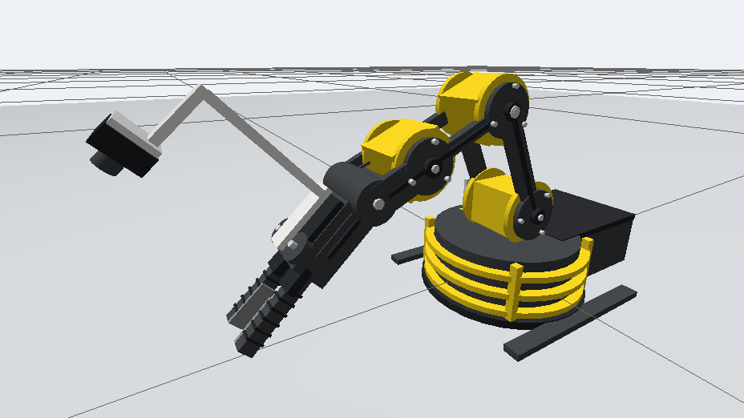
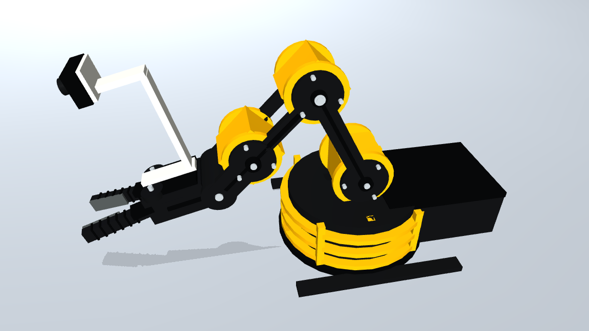

# MotionBrain | 영상 기반 행동 선택을 실물 로봇팔에 연결하기

[English](PORTFOLIO.en.md) · [프로젝트 개요·시작하기](README.md) · [설계·실험 근거](docs/README.md)

**로봇이 지금 보는 장면에서 다음 행동의 결과를 예상하고, 실제 움직임을 다시 보며 목표에 접근하게 만드는 개인 피지컬 AI 프로젝트다.** 5축 DC 로봇팔의 원격조작에서 출발해, 영상·명령·출력을 학습 데이터로 연결하고 행동 선택을 실물 집기·들기·해제로 확장했다. STM32 입력 장치, ESP32 제어기, Raspberry Pi의 ROS2 인터페이스, 두 카메라의 수집·학습·평가 소프트웨어를 구현했다.

35.5초 영상은 고정 카메라 구도와 사람이 준비한 물체·시작 자세에서 촬영한 개발 시험이다. 이후 관절 버튼 입력 없이 두 카메라와 어깨각을 읽어 **접근→집기→들기→내려놓기→해제→빈 팔 후퇴**를 순차 구동했다. 마지막 영상에는 탁상에 서 있는 물체와 물러난 팔이 함께 보인다. [실물 영상](docs/assets/whole-arm-cycle.mp4) · [구동 방식과 시험 조건](docs/whole-arm-cycle.md)

이 프로젝트에서 연결한 핵심은 다음 세 가지다.

- **임베디드 제어와 ROS2:** 센서 피드백·정착 후 보정·명령 수명 관리로 실제 출력과 정지를 다루는 제어 경로를 구현했다.
- **로봇 학습 데이터와 행동 정책:** 원격조작 시연을 행동 단위로 복원하고, 오프라인 모방학습·행동 결과 예측·실물 정책을 각각 구성했다.
- **실물·가상 모델과 평가:** RViz·Gazebo·MuJoCo로 공통 팔 모델을 확인하고, Rerun·W&B로 실제 관측과 예측·모델 비교를 분석했다.

## 센서 피드백을 실제 정지까지 연결한 제어기

OWI-535의 다섯 DC 모터 중 관절각을 직접 읽을 수 있는 축은 어깨(M4) 하나다. 출력 차단 후에도 팔이 관성으로 움직이는 특성을 측정하고, 방향별 조기 차단과 안정화 뒤 AS5600 재측정·보정을 구현했다. 230–245° 범위에서 무하중과 23.10g 하중 각각 11/11회 목표에 도달했으며, 목표와 정착 후 센서값 사이 평균 절대오차는 각각 **0.132°·0.155°**였다. Raspberry Pi의 실물 `ros2_control` 경로에서도 작업자가 확인한 250.00° 목표를 전달해 249.96° 정지를 확인했다. [제어기 실측](docs/evidence/2026-06-28-m4-shoulder-closed-loop.md) · [ROS2 실물 인터페이스](docs/evidence/2026-07-13-m4-physical-ros2-control.md)

원격조작에는 시작·유지·정지를 하나의 조작으로 관리하는 명령 수명 제어를 적용했다. 버튼을 뗀 뒤 늦게 도착한 유지 요청이 모터를 다시 켜지 않도록 종료된 조작을 거부하고, 해당 요청 순서를 네이티브 회귀 시험으로 검증했다. 이 제어 경로는 시연자의 입력과 실제 모터 동작을 대응시키는 기반이 됐다. [회귀 시험](tests/native/test_manual_control_lease.cpp) · [제어기 동작 조건](OPERATIONS.md)

## 원격조작 영상을 모방학습 데이터로 바꾸기

학습에는 물체를 집어 든 영상뿐 아니라 **어떤 관측에서 어떤 행동을 선택했고 실제로 무엇이 출력됐는지**가 필요했다. 외부 카메라의 팔 전체 영상, 집게 위 카메라의 양턱 영상, 버튼 누름·뗌과 드라이버 출력 기록을 대응시키는 수집기를 구현했다. 한 행동에 명령 전 관측·예정 명령·출력과 정지·동작 후 관측을 함께 남기고, 예측 입력에는 실행 전에 확보한 값만 사용했다. [시연 수집기](tools/record_controller_ui.py) · [행동 경계와 라벨](docs/manual-data-collection.md)

전체 팔 원격조작 시연을 9회차까지 기록했다. 첫 시연의 7개 행동을 복원하면서 버튼을 누르고 있는 동안 발생한 유지 요청 98건을 원래 행동에 묶었다. 이 자료를 이용한 **모방학습(IL)**의 첫 실험은 오프라인 행동 복제(Behavior Cloning)로 구성했다. 버튼을 누른 순간의 두 카메라 영상에서 시연자가 선택한 관절과 방향을 예측하는 분류 문제다. 실물 전체 팔 실행에는 아래의 시연 자세 비교 기반 정책을 사용했다.

### 팔 자세가 바뀌어도 영상의 어느 부위를 읽었는가

카메라 시야를 넓히자 위팔과 아래팔이 화면에 선명한데도 기존 표시기가 두 부품을 모두 놓쳤다. 위팔은 팔꿈치 덮개와 레일 양쪽 경계로, 아래팔은 전완·손목 표식과 그 사이에 연결된 재질로 찾도록 수정했다. 수동 집기 시연 7프레임에서 사람이 미리 짚은 부품당 28점을 확인했다. 기존 표시는 위팔과 아래팔에서 각각 0점이었고, 수정 후 올바른 색이 겹친 점은 각각 18점과 24점이었다. 팔을 높이 들면 경계 누락이 남는다. 색칠은 관찰자가 검출 결과를 확인하는 용도이며 행동 모델은 원본 두 영상을 입력받았다. [부품별 결과와 자세별 한계](docs/live-observation.md#광각-부품-표시-검증) · [앞·뒤 자율 시험과 수동 시연 결과](docs/relative-action-selection.md#2026-11-21-앞뒤-배치와-광각-수동-시연)

## 논문의 아이디어를 행동 선택과 실물 정책으로 구현하기

Ebert 등의 *Visual Foresight*에서 가져온 설계 원리는 후보 행동의 결과를 비교하고, 한 동작을 실행한 뒤 새 영상으로 다시 판단하는 것이다. 이 팔에서는 물체 위치·팔 표식·턱 간격처럼 영상에서 읽을 수 있는 상태의 변화량을 예측하도록 구성했다. 영상과 예정 명령을 쓰는 모델을 명령별 평균·무변화 기준선과 비교해, 상태 표현이 행동 선택에 주는 정보를 평가했다. [연구 근거와 설계 판단](docs/research/visual-action-learning.md) · [모델·기준선 비교](docs/evidence/2026-11-04-m4-action-prediction.md)

손목(M2)의 고정 구도 단일 실물 시험에서는 고정 모델이 선택한 명령 한 번으로 영상상 목표 방향 오차가 **5.479°에서 0.967°**로 줄었다. 물체 조작에서는 관절별 모델이 현재 관측과 후보 명령으로 다음 변화를 예측하고, 단계별 목표에 대해 동작과 정지를 비교하도록 연결했다. [M2 실물 선택](docs/evidence/2026-10-31-first-model-goal-approach.md) · [모델 선택 집기·들기·해제](docs/evidence/2026-11-15-prepared-scene-model-grasp-lift-release.md)

전체 팔 실행 정책은 **현재 관측과 시연 자세의 비교, 정해 둔 단계 순서, 영상 기반 정지 조건**을 결합했다. 호스트가 어깨와 집게의 동작을 선택하고, ESP32가 출력·시간·각도 제한과 정지를 담당한다. 집게 열림을 관측하면 출력을 멈추고, 그 이후 촬영된 두 카메라 영상으로 해제를 확인한 뒤 빈 팔을 후퇴시키는 경로까지 연결했다. [전체 팔 실행](docs/whole-arm-cycle.md) · [해제 판정 코드](learning/whole_arm_release.py) · [장치 단계·출력 처리](src/control/whole_arm_service.cpp)

**Rerun**에서는 두 카메라 영상과 측정값을 함께 재생해 예측과 실제 반응을 대조했다. **W&B**에는 모델·기준선 비교와 단계별 결과를 보고서로 남겼다. 아래 화면은 각각 어깨 명령 뒤 물체 상승량의 예측·실측 재생, 세 번의 닫기 동안 턱 간격이 변한 과정이다. [재생·실험 비교 도구](docs/robot-visualization.md)

| Rerun — 영상과 예측·실측 재생 | W&B — 모델·단계별 결과 비교 |
| --- | --- |
|  |  |

## 공통 기하 모델로 실물과 시뮬레이터를 대조하기

실측·조립도·사진에서 링크 치수를 정리해 공통 기하 파일을 만들고, 순기구학(FK)·역기구학(IK) 계산과 URDF 좌표를 대조했다. 두 시연에서는 각각 첫 프레임의 영상상 링크 길이를 기준으로 삼고, 어깨 센서 변화량과 영상에서 읽은 전완 방향으로 후속 프레임의 관절 위치를 추정했다. 이 비교를 통해 고정 도구 좌표계와 집게 개방에 따라 달라지는 실제 턱끝을 관측에서 구분했다. [치수·영상 대조](docs/arm-calibration.md) · [공통 기하 파일](ros2_ws/src/motionbrain_ros_bridge/motionbrain_ros_bridge/arm_geometry.json)

같은 팔 모델을 세 도구로 확인했다. **RViz**에서는 링크·관절축·좌표계를, **Gazebo**에서는 SDF 모델을 불러온 장면의 형상을 점검했다. **MuJoCo**에서는 모델을 렌더링하고 끝점 좌표계(`tool0`)를 URDF·기구학 계산과 수치로 대조했다. 아래는 같은 기하를 바탕으로 만든 팔의 표시 화면이다. [도구별 구성과 검증](docs/robot-visualization.md)

| RViz — 링크와 좌표계 | Gazebo — 가상 장면 구성 | MuJoCo — 모델과 끝점 좌표 대조 |
| --- | --- | --- |
|  |  |  |

## 작업 상태 판독에서 언어 조건 행동·Sim-to-Real로

**시각언어모델(VLM)**은 저장 시연의 작업 상태를 판독하는 데 적용했다. 한 시연의 두 카메라 영상 55쌍을 8구간으로 나눠 사후 평가했고, 마지막 구간의 ‘해제 후 직립’ 판독을 현장 관찰과 대조했다. 이를 출발점으로 관측·언어 지시·행동을 연결하는 **비전·언어·행동 모델(VLA)** 방향을 설계하고 있다. 같은 장면에서 지시만 바꿨을 때 행동 선택이 그에 맞게 달라지는지를 평가할 계획이다. [영상 상태 판독과 행동 학습 설계](docs/visual-action-learning.md)

시뮬레이션의 다음 활용은 같은 모터 명령에 대한 실물·가상 궤적을 비교해 하중·지연·접촉 반응을 보정하는 것이다. 이를 바탕으로 **강화학습(RL)**으로 얻은 정책과 현재 실물 정책을 같은 과제에서 비교하는 Sim-to-Real 평가를 계획하고 있다. 제어·데이터·모델·실물 관측을 연결한 기존 경로를 이 확장의 기반으로 삼는다. [연구·평가 계획](docs/research/visual-action-learning.md) · [공개 코드 검사와 빌드](OPERATIONS.md)
