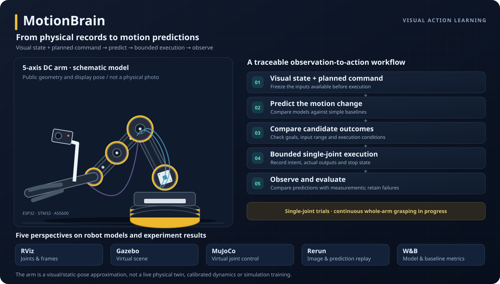

# MotionBrain

[한국어](README.md) · [Portfolio](PORTFOLIO.en.md) · [Build and operations](OPERATIONS.en.md) · [Documentation and evidence (Korean)](docs/README.md)

**A personal robotics project that records physical arm motion and predicts the next change from images and planned commands.** Its goal is to compare candidate outcomes to approach, grasp and lift an object.

An ESP32-controlled five-axis DC arm connects an external camera, a gripper-mounted camera and sensors. The project combines a physical **collection → training → prediction → bounded execution** pipeline with **RViz, Gazebo, MuJoCo, Rerun and W&B** for inspecting robot models and evaluation results.



*An overview of the architecture and data flow in the public source. It is not a physical photograph or a live integration screen.*

Under registered conditions, finite single-joint jobs connect **collection → automatic observation → training → model freeze → evaluation on new actions**. Per-sample manual coordinates are unnecessary, but observation rejection or communication failure stops the job. Unattended whole-arm operation remains unvalidated. **Continuous model-selected autonomous grasping and lifting remain incomplete.** A separate manual contact-and-rise experiment also failed to lift and retain the object.

## From collection to bounded execution

| Stage | Implemented path | Decision criteria |
| --- | --- | --- |
| **1. Collect** | A local Mac UI and finite-job runners collect one joint at a time from M1–M5, recording and replaying images, commands, actual outputs and sensors | Distinguish requests from actual execution; preserve failures, interruptions and unstarted actions |
| **2. Train** | Audit raw hashes, observation windows and output history, then train change predictors on data separated by joint, pose and view | Separate completed storage from training eligibility; check training/evaluation overlap |
| **3. Predict** | Predict each candidate's final state or change from pre-action images and planned commands | Compare with command-mean and no-change baselines; freeze the model before evaluating new data |
| **4. Execute within limits** | Check supported inputs, observation quality and stop state before executing an eligible candidate and observing again | Do not automatically resend failed or uncertain actions; hold the next step |

Prediction uses inputs available before execution. Actual outputs and post-action sensors are kept separate as labels, execution checks and retrospective evidence. Current learning is **supervised action-change prediction and candidate comparison**, rather than a reinforcement-learning policy. The first connection uses only the joints it needs, sequentially; approach poses and motion coverage come afterward.

[Collection and replay (Korean)](docs/manual-data-collection.md) · [Learning design (Korean)](docs/visual-action-learning.md) · [Model selection and sequential execution (Korean)](docs/model-grasp-trial.md)

The [repeatable experiment pipeline (Korean)](docs/experiment-pipeline.md) separates raw single-action collection from later observation and reruns source audits, context-specific training, baseline evaluation and model-version comparisons from an explicit manifest. Software and historical replay verification remain separate from physical operation in a new camera view.

## Inspecting models and experiments

- **RViz, Gazebo and MuJoCo:** Compare arm models derived from shared geometry and approximate static poses. The last measured M4 value can update the display pose; other joints remain assumed. Live pose following, calibrated dynamics and gripper contact models remain incomplete.
- **Rerun and W&B:** Compare source observations, pre-action predictions, measurements and baselines. Rerun distinguishes saved replay from following recorded collection files; only selected metrics useful for decisions are published to W&B.

[Setup, display and validation scope (Korean)](docs/robot-visualization.md) · [Experiment pipeline (Korean)](docs/experiment-pipeline.md)

## Representative results and current status

These experiments use different joints, models and observation conditions. MAE (mean absolute error) averages the magnitude of prediction errors; lower is better. Image-plane angles, sensor angles and pixel errors are not combined into one accuracy measure.

| Experiment | Observed result | Scope |
| --- | --- | --- |
| **M2 model-selected goal approach** | One command reduced image-plane goal error from **5.479° to 0.967°** | Three of four attempts that started recording stopped before actuation. A single same-day, same-view result; repeated grasping remains unvalidated |
| **M4 downward prediction** | Six conditions, **18 training** records and **18 new post-freeze evaluations**. Per-command mean MAE **0.367°**; image-plus-command ridge **0.605°** | Adding this visual representation did not improve prediction |
| **Earlier M1 shaft prediction (Nov 9)** | On **one new close** with the model frozen then: error **0.18px**, command mean **0.03px** | No improvement over the previous model established. Image-plane shaft separation, not physical fingertip, contact or grasp performance |
| **M3 relative-state prediction near the goal** | **18 training** records; among **12 new post-freeze evaluations**, 11 common supported records had mean vector error **1.074px** for ridge and **1.341px** for command mean | Insufficient downward evaluations initially; conditional supplementation still completed only **15/16**, so no overall pass. Zero model-selected approach/grasp/lift actions in that prediction-evaluation cohort |
| **Physical approach with a new M3 development model** | Frozen V2 selected **one UP command**; a fresh image reached the coordinate-wise goal tolerances | One manual return was separate. A single result on the tolerance boundary; repeated correction, repeatability, grasping and lifting remain unvalidated |
| **New model-selected M1 close** | A frozen model compared CLOSE with stop and selected **one physical command**: shaft separation **126.677 → 113.767px**, output OFF verified | Nine manual preparation/collection commands were separate. The 85.3px goal was not reached. Ridge error **1.265px**, command mean **0.989px**: the mean was more accurate. Repeated correction, grasping and lifting remain unvalidated |
| **Manual contact-and-rise experiment** | Closing and rising were observed, but the object stayed on the table: **no retained lift** | Separate from model-selection results. The final rise failed the observed-change criterion |

[M2 goal approach (Korean)](docs/evidence/2026-10-31-first-model-goal-approach.md) · [M4 frozen evaluation (Korean)](docs/evidence/2026-11-04-m4-action-prediction.md) · [Lift models, observations and failures (Korean)](docs/m4-up-commissioning.md) · [M1 evaluation and physical contact experiment (Korean)](docs/evidence/2026-11-09-shaft-evaluation-and-contact-probe.md)

[New M1 model-selected close: conditions, baselines and 13 manual/one model command denominators (Korean)](docs/evidence/2026-11-13-model-selected-m1-close.md)

[New M3 physical approach: conditions, manual preparation and failure denominators (Korean)](docs/evidence/2026-11-13-bounded-m3-approach.md)

[M3 automatic observation, frozen evaluation and incomplete denominators (Korean)](docs/evidence/2026-11-12-m3-goal-prediction.md)

[M2/M3 W&B prediction evaluation report (Korean; no login required)](https://forge.coreweave.com/wandb/henrypark-personal-project/motionbrain-fixed-evaluation/reports/-M2-M3---VmlldzoxODI5OTAzOQ?accessToken=5oatt93qha9x95onnncj8tbsdgk6362irr67javlo0nymassqaaal1mj8rjcl1sz) records model/baseline comparisons, failures and evaluation denominators. That prediction-evaluation cohort executed zero model-selected grasp/lift actions; prediction evaluation remains separate from physical grasp/lift success.

## Physical system

ESP32 manages commands, outputs and stop state for five DC axes; the host handles collection, validation, training and evaluation. The system also connects STM32 sensing/teleoperation and Raspberry Pi perception, dashboard and ROS2 paths.

- **Observation:** An external camera and an ESP32-CAM above the gripper. Current feature tracking is limited to registered views and reference points; general object recognition, depth and contact detection remain unvalidated.
- **Feedback:** Only the M4 shoulder has an AS5600 angle sensor. The other four axes lack position feedback.
- **Physical ROS2 path:** Operator-confirmed single M4 targets have been validated. Whole-arm trajectory tracking remains incomplete.

[Hardware wiring](PIN_MAP.en.md) · [ROS2 hardware interface](ros2_ws/src/motionbrain_hardware_interface/README.en.md)

## Getting started

Start with software checks and firmware builds without connecting a device. Host checks use Python 3.12, `numpy`, `opencv-python-headless`, Node.js (CI: 22) and a C++ compiler. Optional PyTorch checks are skipped without their dependencies; firmware builds require PlatformIO.

```sh
python3 -m unittest discover -s tests
pio run
pio run -d firmware/esp32cam
```

These commands test and build; they do not upload firmware or drive motors. Raw captures and model weights are not in the public repository, so reevaluating experiment scores requires those data.

- **Collection and learning:** [Manual collection guide (Korean)](docs/manual-data-collection.md) for the UI, replay, datasets and training
- **Model and evaluation viewers:** [Visualization guide (Korean)](docs/robot-visualization.md) for virtual-arm display and local evaluation replay
- **Installation, services and physical execution:** [Operations](OPERATIONS.en.md) for execution conditions and stop verification
- **Automated checks:** [PlatformIO/Python CI](https://github.com/ParkJsoo/motionbrain/actions/workflows/platformio.yml) · [ROS2 CI](https://github.com/ParkJsoo/motionbrain/actions/workflows/ros2.yml)

Physical execution requires checking current connections, cameras and movement clearance. Intermittent HTTP latency remains, and the collection UI's abort request does not guarantee an immediate physical emergency stop. Follow the collection and operations guides for details. Passing software checks and validating physical performance are separate outcomes.

## Remaining validation

Shaft-separation prediction, object-to-actual-fingertip geometry, contact and retained lifting each require separate validation. Next steps are checking model support in new views and start poses, evaluating improvement over simple baselines, and measuring repeated grasping performance.

Shared geometry supports software comparisons of FK, IK and URDF, but precision physical joint-zero, camera-extrinsic and dynamics calibration remain incomplete. The current approximate model does not establish physical collision clearance.

[Roles of observation, prediction and kinematics (Korean)](docs/visual-action-learning.md#전체-팔에서-기구학동역학을-쓰는-방법) · [Calibration evidence and limitations (Korean)](docs/arm-calibration.md)

## Code and documentation

| Path | Role |
| --- | --- |
| `learning/`, `tools/` | Collection/replay, source validation, visual measurement, prediction/evaluation, candidate selection and visualization |
| `src/`, `firmware/` | ESP32 motor control, camera and STM32 firmware |
| `ros2_ws/src/` | Messages, bridges, control guards, URDF and hardware interface |
| [Portfolio](PORTFOLIO.en.md) | Problems addressed, design decisions and representative results |
| [Documentation and evidence index (Korean)](docs/README.md) | Guides and dated measurement conditions, failures and denominators |

## Existing teleoperation demo


[Watch MP4](https://raw.githubusercontent.com/ParkJsoo/motionbrain/demo-ready-20260608/docs/assets/demo/motionbrain-demo.mp4) · **Teleoperation at the fixed 2026-06-08 tag.** This is not an autonomous grasping demonstration by the current learned model.

## License

Project code is [MIT](LICENSE). STM32 HAL/CMSIS files retain their upstream licenses under `firmware/stm32/MotionBrainSensor/Drivers/`.
