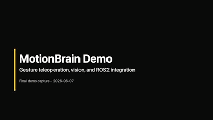

# MotionBrain

[한국어](README.md) · [Portfolio](PORTFOLIO.en.md) · [Build and operations](OPERATIONS.en.md)

The kinematic display uses positive upward elevation and a fixed `tool0` independent of jaw opening. Software checks of FK/IK against URDF positions and orientations do not establish physical dimensions or zero calibration. See [coordinate conventions and limits (Korean)](docs/visual-action-learning.md#전체-팔에서-기구학동역학을-쓰는-방법).

**A personal robotics project that predicts arm motion from images and planned commands, then compares candidate outcomes to grasp and lift an object.** It connects two cameras and sensors to an ESP32-controlled five-axis DC arm, developing collection, raw-data validation, training, evaluation and bounded execution.

The current stage is **connecting joint-specific prediction into an M1 gripper close → M4 shoulder lift sequence**. Automatic alignment and learned whole-arm grasping/lifting are not complete.

## Goal and current stage (2026-11-08)

The intended loop is `current visual state + candidate command → predict change → compare with goal → execute → observe again`. The first task connects only the joints it needs, sequentially; simultaneous control of every joint is not a prerequisite.

| Area | Implementation and observed results |
| --- | --- |
| Collection and validation | A local Mac UI selects one of M1–M5 for a finite pulse, recording/replaying images, command intent, actual outputs, sensors and failures. Completed storage is separate from training eligibility |
| Baseline comparison | Six M4 downward conditions, 18 training records and 18 new evaluations after freezing. Per-command mean MAE **0.367°** versus image-plus-command ridge **0.605°**; this visual representation showed no benefit |
| Lift prediction | With a manually pregrasped object and a fresh reference view, the M4 500ms-candidate model was trained/frozen on four new records and evaluated on two. Object-rise MAE was **2px**, tied with the command mean. Physical selection by this model remains at zero |
| Close-to-lift integration | A new M1 model was frozen on four records at the current pose: two open and two close. This batch used seven physical commands, four for training and three for preparation. **Post-freeze evaluations, model-selected closes and connected close/lift trials are all zero.** Observation ambiguity and narrow model input support stopped the run |

Current gripper-camera observation tracks features only within a registered view and seed-point contract. It does not establish general object perception, depth or contact detection. Pre-action inputs use visual state available at that time and planned commands; actual outputs and post-action sensors serve execution checks, labels and retrospective analysis. Different joints, poses and observation methods are not automatically combined.

An earlier, separate M4 650ms model selected one command for which a physical lift was observed. However, **3.08° of movement exceeded the 3° observational guard, so the original execution remains failed**. The object had been grasped manually; this is neither a result of the current 500ms model nor completed autonomous grasping.

Representative evidence: [current close-to-lift attempt and stop (Korean)](docs/evidence/2026-11-08-close-lift-integration.md) · [M4 learning, lift observations and failures (Korean)](docs/m4-up-commissioning.md) · [18-record frozen evaluation and baselines (Korean)](docs/evidence/2026-11-04-m4-action-prediction.md) · [M2 single model-selected goal approach (Korean)](docs/evidence/2026-10-31-first-model-goal-approach.md). The [evidence index (Korean)](docs/README.md) retains earlier joint-specific and marker experiments under their own conditions.

## Architecture

```text
External camera → Mac collection UI → image/command/output/sensor records
                              │                          │
                     bounded single-joint command   validation → training/evaluation
                              ↓                          ↓
STM32 sensing/teleoperation → ESP32 → 5 DC axes     candidate prediction comparison
                              ↑
                        AS5600: M4 angle

ESP32-CAM → gripper view / Raspberry Pi perception, dashboard and ROS2
```

ESP32 manages commands, outputs and stop state; the host handles collection, training and evaluation. Only M4 has an angle sensor; the other four axes lack position feedback. The existing physical ROS2 path was validated for operator-confirmed single M4 targets, not whole-arm trajectory tracking. Candidate comparison is not connected to automatic control of every joint.

## Getting started

Host checks use Python 3.12, `numpy`, `opencv-python-headless`, Node.js (CI: 22) and a C++ compiler. Optional PyTorch checks are skipped without their dependencies. Firmware builds require PlatformIO.

```sh
python3 -m unittest discover -s tests
pio run
pio run -d firmware/esp32cam
```

These commands test and build; they do not upload firmware or drive motors. Raw captures and model weights are not in the public repository, so reevaluating experiment scores requires those data.

- **Collection, replay, datasets and training:** [manual collection guide (Korean)](docs/manual-data-collection.md), [learning goals and design (Korean)](docs/visual-action-learning.md)
- **Bounded execution and observation contracts:** [relative-state prediction (Korean)](docs/relative-action-selection.md), [model-selected sequential trials (Korean)](docs/model-grasp-trial.md), [external-camera marker learning (Korean)](docs/projected-arm-learning.md)
- **Installation, firmware, services and ROS2:** [operations](OPERATIONS.en.md), [wiring](PIN_MAP.en.md), [ROS2 hardware interface](ros2_ws/src/motionbrain_hardware_interface/README.en.md)
- **Software checks:** [PlatformIO/Python CI](https://github.com/ParkJsoo/motionbrain/actions/workflows/platformio.yml), [ROS2 CI](https://github.com/ParkJsoo/motionbrain/actions/workflows/ros2.yml). Software checks are separate from physical performance.

Physical collection requires checking current connections, camera setup and movement clearance. Failed or uncertain actions are not automatically resent. Intermittent HTTP latency remains; the collection UI's abort request does not guarantee an immediate physical emergency stop. The collection guide specifies execution conditions and stop verification.

## Whole-arm next steps

First establish reliable observation and supported M1 inputs at the current pose, then separately evaluate the frozen model and connect M1 closing, contact review and M4 lifting. Extend to the necessary approach joints and poses afterward.

Kinematics will progressively constrain reachability and movement clearance. Whole-arm inverse-kinematics/dynamics control and a reinforcement-learning policy have not been introduced; current learning is supervised action-change prediction and candidate comparison. Contact/dynamics studies in Gazebo or MuJoCo follow geometry and actuator-response calibration; adopting a simulator is not a prerequisite for the first physical connection.

RViz, Gazebo and MuJoCo display a photo/manual-informed approximation of the OWI-535 with virtual joints and simple mirrored jaws. The default scene hides diagnostic objects and coordinate axes; this is not precision CAD or a physically calibrated model. Rerun provides two-camera fixed-evaluation replay, and W&B supports offline metrics and selective web publishing. See [viewer setup and limits (Korean)](docs/robot-visualization.md). [Physical calibration (Korean)](docs/arm-calibration.md) uses shared geometry and derivative checks; manual readings cover shoulder height, shoulder-to-elbow-to-wrist lengths and the complete wrist-to-gripper-tip distance. Side-photo proportions also inform a static approximate display pose. An offline tool compares projected rotation in saved video against M4 sensor changes; sensor zero and camera extrinsics remain uncalibrated.

## Code and documentation

| Path | Role |
| --- | --- |
| `learning/`, `tools/` | Collection/replay, source validation, visual-state measurement, prediction/evaluation and candidate selection |
| `src/`, `firmware/` | ESP32 motor control, camera and STM32 firmware |
| `ros2_ws/src/` | Messages, bridges, control guards, URDF and hardware interface |
| [Portfolio](PORTFOLIO.en.md) | Problems addressed, design decisions, representative results and limits |
| [Documentation and evidence index (Korean)](docs/README.md) | Guides and dated measurements |

## Existing teleoperation demo



[MP4](https://raw.githubusercontent.com/ParkJsoo/motionbrain/demo-ready-20260608/docs/assets/demo/motionbrain-demo.mp4) · Teleoperation at the fixed 2026-06-08 tag, not a grasping demonstration by the current learned model.

## License

Project code is [MIT](LICENSE). STM32 HAL/CMSIS files retain their upstream licenses under `firmware/stm32/MotionBrainSensor/Drivers/`.
