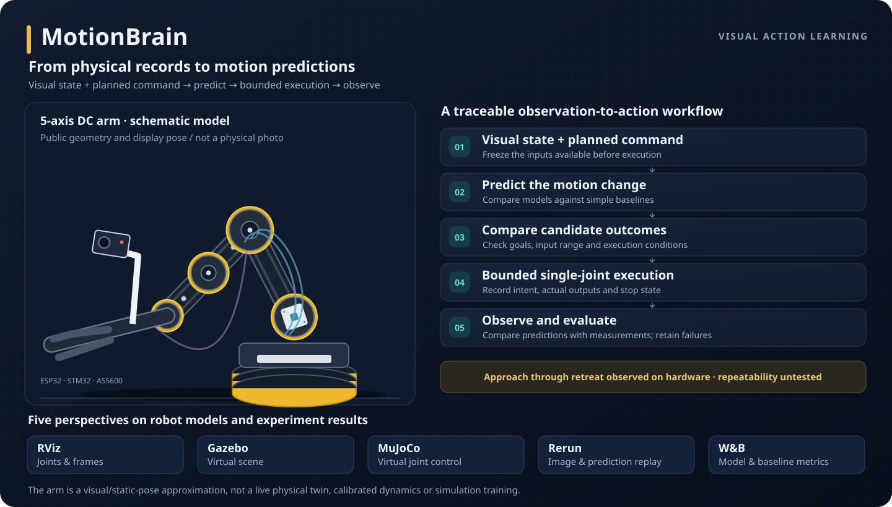
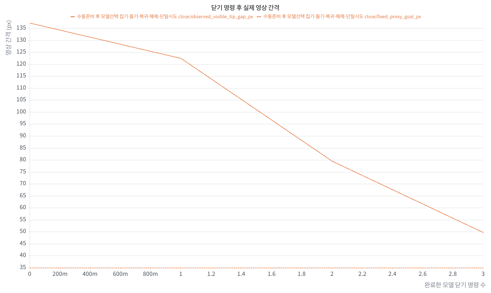

# MotionBrain

[한국어](README.md) · [Portfolio](PORTFOLIO.en.md) · [Physical video · 35.5 s](docs/assets/whole-arm-cycle.mp4) · [Build and operations](OPERATIONS.en.md) · [Technical documentation (Korean)](docs/README.md)

**A personal physical AI project that observes a robot arm and an object through cameras, learns the effects of actions, and selects the next move.** It connects STM32 and ESP32 hardware control with ROS2, demonstrations recorded by two cameras, action prediction and physical policy execution.

[](docs/assets/whole-arm-cycle.mp4)

The fifth development trial in a prepared tabletop scene showed **approach → grasp → lift → lower → release → empty-arm retreat**. After a person prepared the object and starting pose, a policy using both camera views and the shoulder angle drove the shoulder and gripper sequentially without joint-button input. This policy compares current observations with demonstration poses and applies a stage order and visual stopping conditions. [Physical video](docs/assets/whole-arm-cycle.mp4) · [Trial conditions and evaluation (Korean)](docs/whole-arm-cycle.md)

## From observations to actions

Of the OWI-535's five DC axes, the shoulder (M4) has direct joint-angle feedback. An external camera observes the arm and object, while a camera above the gripper observes the jaws relative to the object. The learning and control goal is **observe the current state → predict and compare candidate outcomes → execute one action → reassess from new images**.



| Layer | Implemented role | Code and documentation |
| --- | --- | --- |
| Hardware control | STM32 IMU and button teleoperation, ESP32 motor drive, output limits and stopping, AS5600 shoulder feedback | [Firmware](src/) · [Pin map](PIN_MAP.en.md) |
| ROS2 integration | Raspberry Pi status bridge, kinematics and a physical `ros2_control` interface | [ROS2 hardware interface](ros2_ws/src/motionbrain_hardware_interface/README.en.md) |
| Demonstrations and learning | Alignment of both views with button gestures and actual output, state-change prediction, offline behavior cloning | [Demonstration collection (Korean)](docs/manual-data-collection.md) · [Learning architecture (Korean)](docs/visual-action-learning.md) |
| Action selection | Local models comparing actions with stopping, and a whole-arm policy referencing demonstration poses | [Stage-by-stage model selection (Korean)](docs/evidence/2026-11-15-prepared-scene-model-grasp-lift-release.md) · [Whole-arm execution (Korean)](docs/whole-arm-cycle.md) |

Drawing on *Visual Foresight*'s candidate-outcome comparison and re-observation approach, I implemented models that predict changes in image features and select physical actions. The project also explores **imitation learning (IL) through offline behavior cloning** to predict joint and direction from demonstration images, and **vision-language model (VLM) assessment** of task states in recorded footage. The [portfolio](PORTFOLIO.en.md) and [research notes (Korean)](docs/research/visual-action-learning.md) explain the implementation and design choices.

## From robot models to experiment analysis

Measured link dimensions form a shared geometry model. Five tools support coordinate and geometry checks on the virtual arm, replay of physical actions, and model comparison.

| RViz · links and coordinate frames | Gazebo · SDF scene and geometry checks | MuJoCo · rendering and end-effector coordinate checks |
| --- | --- | --- |
| [](docs/assets/arm-rviz.png) | [](docs/assets/arm-gazebo.png) | [](docs/assets/arm-mujoco.png) |

| Rerun · both views, predictions and measurements | W&B · model, baseline and stage-result comparisons |
| --- | --- |
| [](docs/assets/arm-rerun.png) | [](docs/assets/arm-wandb.png) |

The three robot views show display poses built from the shared geometry. Rerun replays recorded physical observations alongside predictions; W&B reports compare models, baselines and gripper action results. [Running the five tools (Korean)](docs/robot-visualization.md) · [Arm model and image-space comparison (Korean)](docs/arm-calibration.md)

Research extensions include **vision-language-action (VLA)** action selection under different language instructions in the same scene, and **sim-to-real** comparison of a policy trained with **reinforcement learning (RL)** against the physical policy, following a comparison of simulated and physical trajectories under the same commands. [Research and evaluation plan (Korean)](docs/visual-action-learning.md)

## Getting started without hardware

Host tests use Python 3.12, NumPy, OpenCV, Node.js and a C++ compiler. Optional PyTorch tests may be skipped depending on installed dependencies. Firmware builds use PlatformIO.

Start with the gripper release check using synthetic observations. It checks jaw opening, the object's table reference position, and fresh observations from both cameras after confirmed motor output.

```sh
python3 -m unittest discover -s tests -p 'test_whole_arm_release.py'
```

Full host tests and firmware builds:

```sh
python3 -m unittest discover -s tests
pio run                                      # Default controller
pio run -e esp32dev_whole_arm_policy          # Controller for the whole-arm policy
pio run -d firmware/esp32cam                  # Gripper camera
```

The [operations guide](OPERATIONS.en.md) covers dependency installation, device configuration and services. Source checks and builds can be reproduced from the public repository. Recomputing the original physical measurements requires private recordings, models and camera registration data; the whole-arm trial also used a local host runner. [PlatformIO CI](https://github.com/ParkJsoo/motionbrain/actions/workflows/platformio.yml) · [ROS2 CI](https://github.com/ParkJsoo/motionbrain/actions/workflows/ros2.yml)

## License

Project code uses the [MIT License](LICENSE). Third-party STM32 HAL/CMSIS files under `firmware/stm32/MotionBrainSensor/Drivers/` retain their original licenses.
