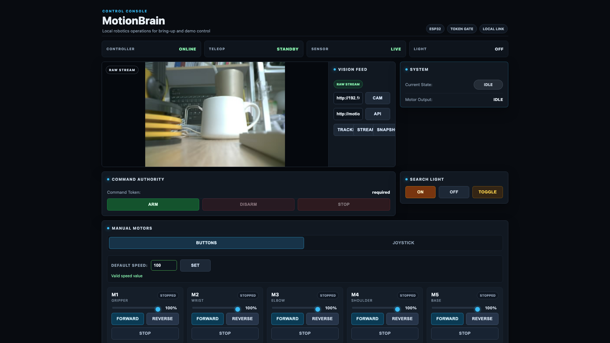

# MotionBrain

[한국어](README.md) · [Portfolio](PORTFOLIO.en.md) · [Build and operations](OPERATIONS.en.md)

A personal robotics project integrating an ESP32-controlled five-axis DC arm, STM32 sensing and teleoperation, ESP32-CAM, Raspberry Pi, and ROS2 Jazzy. Motor control is separated from host decisions and evaluated using sensor feedback and recorded failures.

## Demo


[MP4](https://raw.githubusercontent.com/ParkJsoo/motionbrain/demo-ready-20260608/docs/assets/demo/motionbrain-demo.mp4) · Teleoperation from the fixed 2026-06-08 tag; this is not an autonomous grasp demonstration.

## Implementation and validation

| Area | Demonstrated result | Limit |
| --- | --- | --- |
| Embedded control | Five-axis ESP32 PWM, STM32 UART teleoperation, state machine, deadman and sensor-fault gating | Electrical stop latency and certified functional safety are unverified |
| M4 shoulder feedback | AS5600 target control; final no-added-load and 23.10g regressions each passed 11/11 | Fixed mount and limited range on 2026-06-28; no position feedback on the other four axes |
| ROS2 integration | Typed messages, URDF/RViz, control guard, `ros2_control` | Physical writes validated only for operator-confirmed single M4 targets |
| Observed manipulation | Lipbalm grasp/lift followed by two additional grasp/place cycles | An external observer selected manual commands from camera views; first repeat required correction; not a learned policy |
| Perception and learning code | Pretrained YOLOv5s inference, NumPy ridge training/evaluation, offline lip-balm/gripper data loading, direction display and relative-position evaluation | Zero eligible physical action transitions. New CV tools checked with synthetic predictions; custom model training, autonomous grasping and learning gains unverified |

## Architecture

```text
STM32 (IMU / teleoperation) ── UART ──> ESP32 (commands / safety / PWM) ──> 5 DC axes
                                          ↑ AS5600 feedback on M4 only
ESP32-CAM ── HTTP /capture ──> Raspberry Pi (perception / dashboard / ROS2)
                                  └─ M4 proposal → operator confirmation → ESP32
```

- Physical outputs pass through the ESP32 `Dispatcher` and `SafetyGate`. Command acceptance is distinct from target attainment.
- Direct camera `/stream` is disabled; images use `/capture` or Pi tracked frames.
- Full-arm closed-loop trajectories and autonomous picking are not implemented. Intermittent HTTP latency remains unresolved.



An existing static UI example, not the current device state.

## Code and documentation

| Path | Contents |
| --- | --- |
| `src/`, `firmware/` | ESP32 controller/camera and STM32 firmware |
| `ros2_ws/src/` | Messages, bridge, control guard, model and hardware interface |
| `learning/`, `tools/` | Perception, data contracts, offline learning/evaluation and operations tools |
| [PORTFOLIO.en.md](PORTFOLIO.en.md) | Design decisions, failure analysis and qualified measurements |
| [OPERATIONS.en.md](OPERATIONS.en.md) | Builds, service configuration, health checks and diagnostics |
| [PIN_MAP.en.md](PIN_MAP.en.md) | Motor/sensor wiring and boot-pin constraints |
| [ROS2 hardware interface](ros2_ws/src/motionbrain_hardware_interface/README.en.md) | Dry-run, measured-state and M4 proposal modes |
| [Data and learning pipeline (Korean)](docs/data-pipeline.md) | Action records, eligibility, splits and reproducible training/evaluation |
| [Offline lip-balm/gripper CV (Korean)](docs/offline-cv.md) | Approved data loader with an optional PyTorch input adapter, candidate previews, and detection/direction/relative-position evaluation of saved predictions |

## Local builds and checks

Host Python dependencies are `numpy` and `opencv-python-headless`; firmware builds require PlatformIO. See [operations](OPERATIONS.en.md) for ROS2 and service setup.

```sh
python3 -m unittest discover -s tests
pio run
pio run -d firmware/esp32cam
```

[PlatformIO/Python CI](https://github.com/ParkJsoo/motionbrain/actions/workflows/platformio.yml) · [ROS2 CI](https://github.com/ParkJsoo/motionbrain/actions/workflows/ros2.yml). Results are commit-specific software checks, separate from physical performance.

## License

Project code is [MIT](LICENSE). STM32 HAL/CMSIS files retain their upstream licenses under `firmware/stm32/MotionBrainSensor/Drivers/`.
