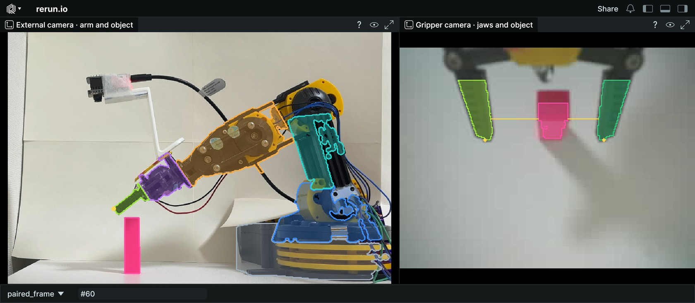
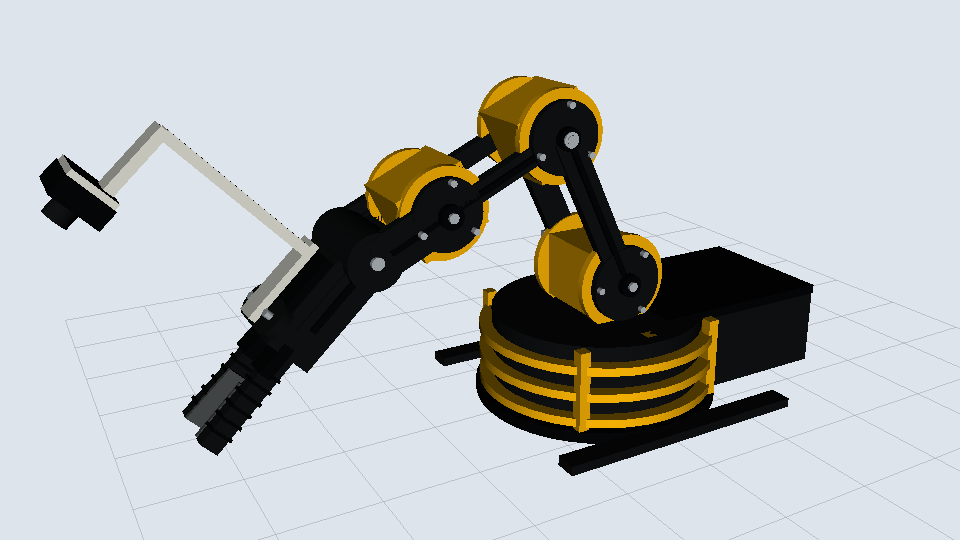

# MotionBrain

[English](README.en.md) · [포트폴리오](PORTFOLIO.md) · [실물 영상 · 35.5초](docs/assets/whole-arm-cycle.mp4) · [빌드·운영](OPERATIONS.md) · [기술 문서](docs/README.md)

**영상으로 로봇팔과 물체를 관측하고, 행동의 결과를 학습해 다음 동작을 선택하는 개인 피지컬 AI 프로젝트입니다.** STM32·ESP32의 실물 제어에서 시작해 ROS2, 두 카메라의 시연 데이터, 행동 예측과 실물 정책 실행을 연결했습니다.

[](docs/assets/whole-arm-cycle.mp4)

준비된 탁상 장면의 다섯 번째 개발 시험에서 **접근 → 집기 → 들기 → 내려놓기 → 해제 → 빈 팔 후퇴**를 관찰했습니다. 사람이 물체와 시작 자세를 준비한 뒤, 두 카메라와 어깨각을 읽는 정책이 관절 버튼 입력 없이 어깨와 집게를 순차 구동했습니다. 이 정책은 현재 관측과 시연 자세를 비교하고 단계 순서와 영상 정지 조건을 적용합니다. [실물 영상](docs/assets/whole-arm-cycle.mp4) · [시험 조건과 평가](docs/whole-arm-cycle.md)

## 관측에서 행동까지

OWI-535의 5축 DC 모터 중 직접 관절각을 읽는 축은 어깨(M4)입니다. 외부 카메라로 팔과 물체의 움직임을, 집게 위 카메라로 양턱과 물체의 상대 위치를 관측합니다. 프로젝트의 학습·제어 목표는 **현재 상태 관측 → 후보 결과 예측·비교 → 한 동작 실행 → 새 영상에서 재판단**입니다.



수동 집기 시연에서 기록한 한 쌍을 Rerun에서 재생한 화면입니다. 왼쪽은 외부 카메라, 오른쪽은 집게 카메라입니다. 수집기가 받은 영상에서 부품 윤곽을 찾아 Rerun에 겹쳐 표시합니다. 청록색 위팔의 검은 레일 일부처럼 검출이 빠진 곳도 원본과 함께 볼 수 있습니다. [표시 방법과 구도별 검증](docs/live-observation.md#광각-부품-표시-검증)


| 구성 | 구현한 역할 | 코드·문서 |
| --- | --- | --- |
| 실물 제어 | STM32 IMU·버튼 원격조작, ESP32 모터 구동·출력 제한·정지, AS5600 어깨 피드백 | [펌웨어](src/) · [핀맵](PIN_MAP.md) |
| ROS2 연동 | Raspberry Pi의 상태 브리지, 기구학, `ros2_control` 실물 인터페이스 | [ROS2 하드웨어 인터페이스](ros2_ws/src/motionbrain_hardware_interface/README.md) |
| 시연·학습 | 두 영상과 버튼 조작·실제 출력의 연결, 상태 변화 예측, 오프라인 행동 복제 | [시연 수집](docs/manual-data-collection.md) · [학습 구조](docs/visual-action-learning.md) |
| 행동 선택 | 국소 모델의 동작·정지 후보 비교, 시연 자세를 참조하는 전체 팔 정책 | [단계별 모델 선택](docs/evidence/2026-11-15-prepared-scene-model-grasp-lift-release.md) · [전체 팔 실행](docs/whole-arm-cycle.md) |

*Visual Foresight*의 후보 결과 비교와 재관측 아이디어를 참고해, 영상 특징의 변화량을 예측하는 모델과 실물 행동 선택을 구현했습니다. 시연 영상에서 관절·방향을 예측하는 **모방학습(IL)의 오프라인 행동 복제**와, 저장 영상의 작업 상태를 읽는 **비전 언어 모델(VLM) 판독**도 다뤘습니다. 각 접근의 구현과 적용 판단은 [포트폴리오](PORTFOLIO.md)와 [연구 근거](docs/research/visual-action-learning.md)에 정리했습니다.

## 로봇 모델부터 실험 분석까지

실측 링크 치수를 공통 기하 모델로 관리하고, 가상 팔의 좌표·형상 확인과 실제 행동의 재생·모델 비교에 다섯 도구를 활용했습니다.

| RViz · 링크와 좌표계 확인 | Gazebo · SDF 장면과 형상 점검 | MuJoCo · 팔 렌더링과 끝점 좌표 대조 |
| --- | --- | --- |
| [](docs/assets/arm-rviz.png) | [](docs/assets/arm-gazebo.png) | [](docs/assets/arm-mujoco.png) |

| Rerun · 두 영상과 예측·실측 재생 | W&B · 모델·기준선과 단계별 결과 비교 |
| --- | --- |
| [](docs/assets/arm-rerun.png) | [](docs/assets/arm-wandb.png) |

세 로봇 화면은 공통 기하에서 만든 표시용 자세입니다. Rerun은 저장된 실제 관측과 예측을 함께 재생하고, W&B 보고서는 모델·기준선 및 집게 동작 결과를 비교합니다. [다섯 도구 실행](docs/robot-visualization.md) · [팔 모델과 영상 대조](docs/arm-calibration.md)

연구 확장 방향은 같은 장면에서 언어 지시에 따라 행동을 선택하는 **비전·언어·행동 모델(VLA)**, 실물 명령 반응과 가상 궤적을 대조한 뒤 시뮬레이션에서 **강화학습(RL)**한 정책을 실물 정책과 비교하는 **Sim-to-Real**입니다. [연구·평가 계획](docs/visual-action-learning.md)

## 장치 없이 시작하기

호스트 검사는 Python 3.12, NumPy, Pillow, OpenCV, Node.js와 C++ 컴파일러를 사용합니다. 선택적 PyTorch 검사는 설치된 의존성에 따라 건너뜁니다. 펌웨어 빌드는 PlatformIO를 사용합니다.

먼저 합성 관측으로 집게 해제 판정을 확인할 수 있습니다. 턱의 벌어짐·물체의 탁상 기준 위치·출력 확인 이후 두 카메라 관측의 최신성을 검사합니다.

```sh
python3 -m unittest discover -s tests -p 'test_whole_arm_release.py'
```

전체 호스트 검사와 펌웨어 빌드:

```sh
python3 -m unittest discover -s tests
pio run                                      # 기본 제어기
pio run -e esp32dev_whole_arm_policy          # 전체 팔 정책용 제어기
pio run -d firmware/esp32cam                  # 집게 카메라
```

[운영 안내](OPERATIONS.md)에 의존성 설치와 장치별 설정·서비스 실행 방법이 있습니다. 공개 저장소에서는 코드 검사와 빌드를 재현할 수 있습니다. 실물 영상의 원본 수치 재계산에는 비공개 촬영·모델·구도 등록 자료가 필요하며, 전체 팔 시험은 로컬 호스트 실행기를 함께 사용했습니다. [PlatformIO CI](https://github.com/ParkJsoo/motionbrain/actions/workflows/platformio.yml) · [ROS2 CI](https://github.com/ParkJsoo/motionbrain/actions/workflows/ros2.yml)

## 라이선스

프로젝트 코드는 [MIT](LICENSE)를 따릅니다. STM32 HAL/CMSIS 외부 제공 파일은 `firmware/stm32/MotionBrainSensor/Drivers/`의 원래 라이선스를 따릅니다.
