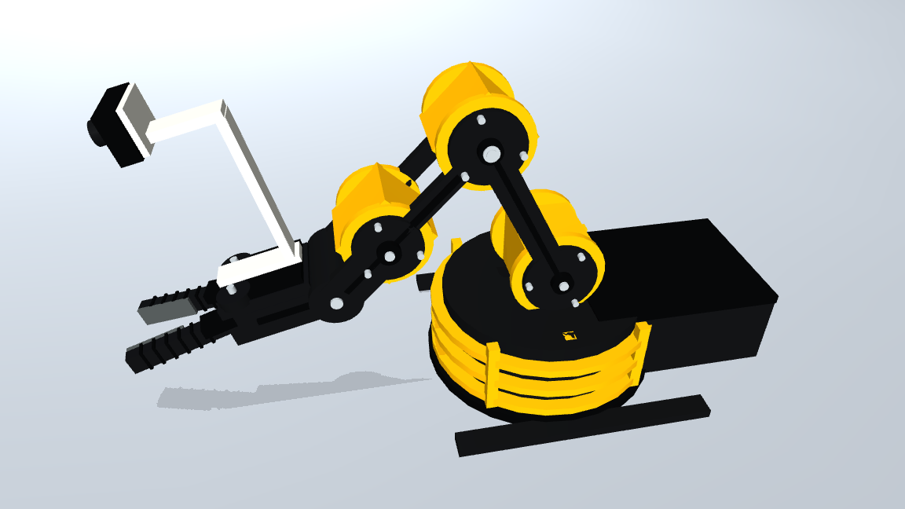

# MotionBrain

[English](README.en.md) · [포트폴리오](PORTFOLIO.md) · [실물 시험 영상 · 35.5초](docs/assets/whole-arm-cycle.mp4) · [빌드·운영](OPERATIONS.md) · [문서·실험 색인](docs/README.md)

**MotionBrain은 팔과 물체의 현재 모습, 그리고 다음에 보낼 명령으로 움직임의 변화를 예측하는 개인 피지컬 AI 프로젝트다.** 목표는 가능한 동작의 결과를 비교해 하나를 실행하고, 실제로 무엇이 움직였는지 다시 보면서 목표에 다가가는 것이다.

다섯 번째 실물 개발 시험에서는 사람이 물체와 팔의 시작 자세를 준비한 뒤, 팔이 관절 버튼 입력 없이 다가가 물체를 잡고 들어 올렸다. 이어 물체를 내려놓고 집게를 연 뒤 빈 팔로 물러났다. 마지막 장면에는 탁상에 서 있는 물체와 후퇴한 팔이 함께 보인다. [35.5초 실물 영상](docs/assets/whole-arm-cycle.mp4) · [개발 시험 5건과 판정](docs/whole-arm-cycle.md)


## 한 관절에서 전체 팔까지

OWI-535의 다섯 DC 모터 중 각도를 직접 읽을 수 있는 곳은 어깨(M4) 하나다. STM32의 IMU·버튼으로 팔을 원격조작하고 ESP32로 모터를 구동하는 데서 출발해, 어깨가 전원을 끈 뒤에도 관성으로 움직이는 양을 측정했다. 안정화 뒤 각도를 다시 확인하는 제어로 230–245° 범위에서 무하중과 23.10g 하중 각각 11/11회 목표에 도달했다. 센서 기준 평균 절대오차는 각각 0.132°와 0.155°였다. Raspberry Pi의 ROS2 경로로도 작업자가 확인한 목표 250.00°에 어깨가 249.96°로 정지하는 것을 확인했다. [초기 원격조작 영상](docs/assets/demo/motionbrain-demo.mp4) · [하중별 어깨 시험](docs/evidence/2026-06-28-m4-shoulder-closed-loop.md) · [ROS2 실물 인터페이스](ros2_ws/src/motionbrain_hardware_interface/README.md)

손목처럼 센서가 없는 관절은 외부 카메라에서 팔의 움직임을 읽었다. *Visual Foresight*에서 참고한 것은 동작의 결과를 예측해 하나를 고르고 다시 관측하는 방식이다. 이 팔에서는 짧은 모터 명령에 따라 영상 속 특징점이 얼마나 움직일지 학습했다. 손목(M2) 시험에서 모델이 고른 한 동작으로 영상상 목표 각도 오차가 **5.479°에서 0.967°**로 줄었다. 촬영을 시작한 네 시도 중 모터를 구동한 것은 이 한 번이었다. 어깨 하강에서는 새 동작 18건의 예측 오차가 영상·명령 모델에서 0.605°, 같은 명령의 평균을 쓴 기준선에서 0.367°였다. [M2 실물 선택](docs/evidence/2026-10-31-first-model-goal-approach.md) · [M4 기준선 비교](docs/evidence/2026-11-04-m4-action-prediction.md) · [논문에서 가져온 설계](docs/research/visual-action-learning.md)

물체 조작으로 넘어가면서는 집게 위 카메라로 턱과 물체의 상대 위치도 관측했다. 수동 시연에서는 한 번 누르고 뗀 동작을 두 영상과 실제 모터 출력에 맞췄다. 이 기록은 사람이 버튼을 누른 시점의 영상으로 관절과 방향을 예측하는 **오프라인 모방학습**에 썼다. 위 실물 영상에서 팔을 구동한 정책은 시연 자세와 현재 관측을 비교하고, 정해 둔 단계 순서와 영상 정지 조건에 따라 어깨와 집게를 순차 구동했다. [시연 수집](docs/manual-data-collection.md) · [단계별 모델 선택 실험](docs/evidence/2026-11-15-prepared-scene-model-grasp-lift-release.md) · [전체 팔 실행과 평가](docs/whole-arm-cycle.md)


## 실제 팔과 가상 모델을 어떻게 대조했나

실물 치수로 링크 모델을 만들고 순기구학·역기구학의 좌표를 URDF와 대조했다. **RViz**에서는 링크와 좌표계를, **Gazebo**와 **MuJoCo**에서는 같은 기하로 만든 팔의 자세를 확인했다. 실물 영상에서는 각 시연의 첫 장면을 기준으로 어깨 센서값과 영상에서 읽은 전완 방향을 이용해 팔의 위치를 추적했다. 팔꿈치와 손목보다 집게 끝에서 영상과의 차이가 컸다. [팔 모델·실물 영상 대조](docs/arm-calibration.md)

| RViz | Gazebo | MuJoCo |
| --- | --- | --- |
| [](docs/assets/arm-rviz.png) | [](docs/assets/arm-gazebo.png) | [](docs/assets/arm-mujoco.png) |

실물에서 예측대로 움직였는지는 **Rerun**에서 영상과 측정값을 함께 재생해 확인했다. 아래 어깨 상승 장면의 물체 상승량은 예측 17px, 실측 21px다. **W&B**에는 후속 모델 선택에 쓸 비교를 남겼다. 오른쪽 보고서는 별도 집게 실험에서 세 번 닫는 동안 턱 사이 간격이 137.24px에서 49.70px로 변한 과정을 목표 간격 35px와 함께 보여준다. [관측·도구 실행](docs/robot-visualization.md) · [W&B 보고서와 시험 조건](docs/evidence/2026-11-15-prepared-scene-model-grasp-lift-release.md#모델-비교-보고서)

| Rerun | W&B |
| --- | --- |
| [](docs/assets/arm-rerun.png) | [](docs/assets/arm-wandb.png) |

## 장치 없이 시작하기

호스트 검사에는 Python 3.12, NumPy, OpenCV, Node.js와 C++ 컴파일러가 필요하다. 선택적 PyTorch 검사는 설치된 의존성에 따라 건너뛴다. 펌웨어 빌드에는 PlatformIO를 사용한다.

합성 영상으로 집게 해제 시점을 검사해 볼 수 있다. 아래 테스트는 턱이 충분히 벌어졌는지, 물체가 탁상 기준 위치에 있는지, 두 카메라 모두 출력 확인 뒤의 새 관측을 제공했는지 확인한다.

```sh
python3 -m unittest discover -s tests -p 'test_whole_arm_release.py'
```

전체 호스트 검사와 펌웨어 빌드는 다음 명령으로 실행한다.

```sh
python3 -m unittest discover -s tests
pio run
pio run -d firmware/esp32cam
```

[운영 안내](OPERATIONS.md)에 환경별 설치·서비스·실물 실행 조건이 있다. 공개 저장소에서 코드 검사와 빌드를 재현할 수 있다. 원 실험의 수치를 다시 계산하려면 비공개 촬영 원본과 모델·구도 등록 자료가 필요하며, 전체 팔 실물 시험은 로컬 호스트 실행기도 사용했다. [PlatformIO CI](https://github.com/ParkJsoo/motionbrain/actions/workflows/platformio.yml) · [ROS2 CI](https://github.com/ParkJsoo/motionbrain/actions/workflows/ros2.yml)

## 다음 실험

다음 전체 팔 시험에서는 물체가 탁상에 서 있고 빈 팔이 충분히 물러났는지를 시연 자세 재현도와 따로 평가한다. 저장 시연 한 건에서 두 카메라로 해제 후 직립 상태를 판독한 비전 언어 모델(VLM)은 새 시연에서도 평가할 예정이다. 같은 장면에 다른 지시를 주고 행동이 달라지는지 묻는 것이 이후 비전·언어·행동 모델(VLA)의 과제다. 시뮬레이션에서는 같은 명령의 가상·실물 궤적부터 비교한 뒤, 강화학습으로 얻은 정책이 실물에서도 목표에 도달하는지 검증할 계획이다. [평가 설계](docs/visual-action-learning.md)

## 라이선스

프로젝트 코드는 [MIT](LICENSE)를 따른다. STM32 HAL/CMSIS 외부 제공 파일은 `firmware/stm32/MotionBrainSensor/Drivers/`의 원래 라이선스를 따른다.
