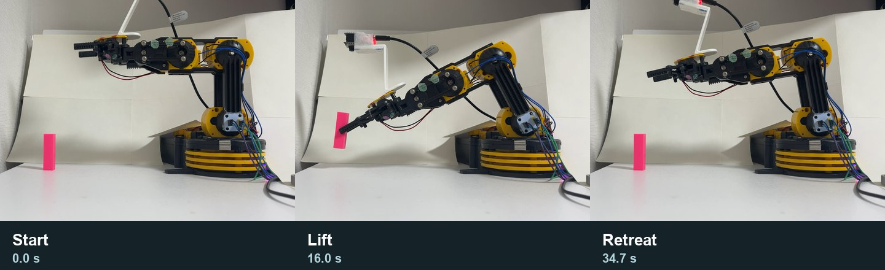

# MotionBrain

[English](README.en.md) · [포트폴리오](PORTFOLIO.md) · [빌드·운영](OPERATIONS.md) · [문서 색인](docs/README.md)

MotionBrain은 **실물 로봇팔이 자기 행동의 결과를 학습하고, 그 예측을 이용해 주어진 목표에 도달하도록 하는** 개인 피지컬 AI 프로젝트다. 팔은 현재 영상과 관절 명령을 바탕으로 각 후보가 팔과 물체의 상태를 어떻게 바꿀지 예측한다. 후보를 비교해 한 동작을 실행한 뒤 두 카메라로 결과를 다시 보고, 목표까지 남은 차이에 따라 다음 동작을 고른다. 5축 중 관절각을 직접 읽는 축은 어깨 하나다.

아래 영상은 이 프로젝트의 탁상 조작 시험이다. 사람이 원격조작한 시연을 활용해 접근부터 물체 해제와 빈 팔 후퇴까지 연결했다.



[실물 동작 영상(MP4)](docs/assets/whole-arm-cycle.mp4) · [시험 조건·단계별 결과](docs/whole-arm-cycle.md)

**자율 시험 5회차에서는 처음부터 마지막 후퇴까지 관절 버튼을 누르지 않고 여섯 단계를 실행했다.** 분홍 물체가 들렸다가 탁상에 돌아왔고, 집게 열림을 확인해 출력을 멈춘 뒤 새 영상으로 빈 팔 후퇴에 진입했다. 마지막에는 물체가 서 있었고 모터 5축 모두 OFF였다.

이 시험의 **기존 판정은 실패**다. 물체의 최대 상승은 목표 226.25px 중 166px였고, 후퇴 중 모델이 종료를 고른 어깨 각도는 214.98°로 수동 시연 종료 범위 하한 216.65°에 못 미쳤다. 마지막 영상에서 집게와 물체의 세로 간격은 물체 높이의 약 1.42배였다. 정지 뒤 3초 안정성과 여러 시작 자세에서의 반복 성공률은 다음 평가 과제다.

## 무엇이 팔을 움직이는가

| 구성 | 맡은 일 |
| --- | --- |
| 시연 수집기 | 사람이 UI에서 누르고 뗀 관절 명령을 두 카메라 프레임, 제어기가 기록한 실제 PWM 출력과 대조한다. 같은 버튼의 유지 요청은 한 동작으로 묶는다. |
| 호스트의 행동 정책 | 현재 영상과 수동 시연을 비교하고 단계별 모델·규칙으로 후보 동작이나 정지를 선택한다. 동작 뒤 새 관측을 받아 다음 단계를 판단한다. |
| ESP32·STM32 | ESP32가 모터 출력과 정지를 관리하고 STM32가 센서·원격조작 경로에 참여한다. M4 어깨의 AS5600만 관절각을 직접 읽는다. |
| Raspberry Pi·ROS2 | 인식·대시보드·ROS2 경로를 제공한다. ROS2를 통한 단일 M4 목표 실행을 실물에서 별도로 검증했다. |

행동 예측 모델은 실행 전에 얻은 영상·센서값과 예정 명령을 사용한다. 실제 출력과 사후 영상은 명령이 어떻게 실행됐는지 검증하고 학습 정답을 만드는 데 쓴다. [수집과 재생](docs/manual-data-collection.md) · [전체 팔 학습 설계](docs/visual-action-learning.md) · [배선](PIN_MAP.md) · [ROS2 하드웨어 인터페이스](ros2_ws/src/motionbrain_hardware_interface/README.md)

## 장치 없이 시작하기

Python 3.12, NumPy, OpenCV, Node.js와 C++ 컴파일러로 호스트 검사를 실행할 수 있다. 펌웨어 빌드에는 PlatformIO를 사용한다. 선택적 PyTorch 검사는 의존성 설치 여부에 따라 건너뛸 수 있다.

```sh
python3 -m unittest discover -s tests
pio run
pio run -d firmware/esp32cam
```

공개 저장소로 코드 검사와 빌드를 재현할 수 있다. 실험 수치를 다시 계산하려면 해당 촬영의 원본·모델·구도 등록 자료가 필요하다. 실물 시험에는 로컬 호스트 실행기도 사용했다. [운영 안내](OPERATIONS.md) · [PlatformIO/Python CI](https://github.com/ParkJsoo/motionbrain/actions/workflows/platformio.yml) · [ROS2 CI](https://github.com/ParkJsoo/motionbrain/actions/workflows/ros2.yml)

## 더 살펴보기

- **정책이 무엇을 배웠나?** 시연 기반 행동 선택, 관절별 반응 예측, 단순 기준선과의 비교를 포트폴리오에서 다룬다. [설계 판단과 실측](PORTFOLIO.md)
- **이전 실험과 무엇이 달라졌나?** 11월 15일에는 상위 실험 진행자가 단계를 바꿨고 모델이 단계 안의 동작을 골랐다. 당시 직접 DOWN 학습 자료가 없어 내리기는 UP 역응답 가설을 썼다. [당시 실물 결과와 시도 분모](docs/evidence/2026-11-15-prepared-scene-model-grasp-lift-release.md)
- **모델과 실물은 얼마나 일치하나?** RViz·Gazebo·MuJoCo로 공통 기하를 대조하고 Rerun으로 영상을 재생하며 W&B로 고정 모델·기준선을 비교한다. 실물에서 보정된 동역학과 Sim-to-Real 성능은 검증 과제로 남아 있다. [기구학 보정](docs/arm-calibration.md) · [시각화와 실험 도구](docs/robot-visualization.md)

## 라이선스

프로젝트 코드는 [MIT](LICENSE)다. STM32 HAL/CMSIS 외부 제공 파일은 `firmware/stm32/MotionBrainSensor/Drivers/`의 원래 라이선스를 따른다.
