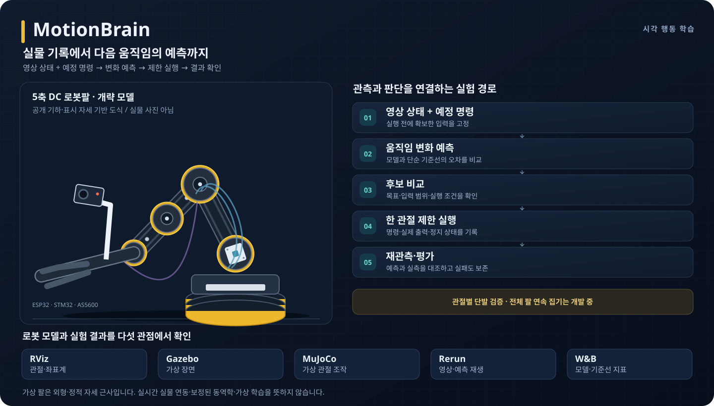
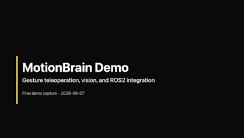

# MotionBrain

[English](README.en.md) · [포트폴리오](PORTFOLIO.md) · [빌드·운영](OPERATIONS.md) · [문서·실험 증거](docs/README.md)

**실제 로봇팔의 움직임을 기록하고, 영상과 예정 명령으로 다음 변화를 예측하는 개인 로보틱스 프로젝트다.** 후보 동작의 예측 결과를 비교해 물체에 접근하고, 잡고, 드는 과정을 목표로 한다.

ESP32 기반 5축 DC 로봇팔에 외부 카메라·집게 위 카메라와 센서를 연결했다. 실물의 **수집 → 학습 → 예측 → 제한 실행** 경로와, 로봇 모델·평가 결과를 확인하는 **RViz·Gazebo·MuJoCo·Rerun·W&B**를 함께 구축하고 있다.



*공개 소스의 구성과 데이터 흐름을 정리한 개요도다. 실물 사진이나 실시간 연동 화면이 아니다.*

등록한 조건에서 한 관절의 유한 작업을 **수집 → 자동 관측 → 학습 → 모델 고정 → 새 동작 평가**로 연결했다. 매 표본의 수동 좌표 입력 없이 실행하되 관측 거절·통신 실패에서는 멈추며, 전체 팔의 무개입 자동 운전은 아직 검증하지 않았다. **모델 선택에 기반한 연속 자동 집기·들기는 미완료**이며, 별도 수동 접촉·상승 시험에서도 물체를 들어 유지하지 못했다.

## 수집에서 제한 실행까지

| 단계 | 구현한 경로 | 판단 기준 |
| --- | --- | --- |
| **1. 수집** | Mac 로컬 UI·유한 작업 실행기로 M1~M5 중 한 관절씩 수집하고 영상·명령·실제 출력·센서를 저장·재생 | 요청과 실제 실행을 구분하고 실패·중단·미시작도 보존 |
| **2. 학습** | 원본 해시·관측창·출력 이력을 심사하고 관절·자세·촬영 조건별 자료로 변화 예측 모델 학습 | 저장 완료와 학습 적격을 분리하고 학습·평가 중복 검사 |
| **3. 예측** | 실행 전 영상 상태와 예정 명령으로 후보별 종료 상태·변화량 예측 | 명령 평균·무변화 기준과 비교하고 모델을 고정한 뒤 새 자료 평가 |
| **4. 제한 실행** | 지원 입력 범위·관측 품질·정지 상태를 검사한 뒤 적격 후보를 실행하고 재관측 | 실패·불확실한 실행은 자동 재전송하지 않고 다음 단계 보류 |

예측에는 실행 전에 확보한 입력만 사용한다. 실제 출력과 동작 후 센서는 정답·실행 검증·사후 분석으로 분리한다. 현재 학습은 **지도학습 기반 동작 변화 예측과 후보 비교**이며 강화학습 정책은 아니다. 필요한 관절부터 순서대로 연결하고, 이후 접근 자세와 동작 범위를 넓힌다.

[수집·재생 안내](docs/manual-data-collection.md) · [학습 설계](docs/visual-action-learning.md) · [모델 선택과 순차 실행](docs/model-grasp-trial.md)

[반복 실험 파이프라인](docs/experiment-pipeline.md)은 단발 원본 수집을 사후 관측과 분리하고, 명시적 manifest로 원본 감사·관측·구도별 학습·기준선 및 모델 버전 비교를 재실행한다. 소프트웨어·과거 원본 재생 검증과 새 구도의 실물 운영 검증은 구분한다.

## 모델과 실험 확인

- **RViz·Gazebo·MuJoCo:** 공통 기하에서 만든 팔 모델과 정적 근사 자세를 비교한다. 마지막 M4 실측값을 표시 자세에 반영할 수 있으며, 다른 관절은 가정값이다. 실시간 자세 추종·보정된 동역학·집게 접촉 모델은 미완료다.
- **Rerun·W&B:** 원본 관측·사전 예측·실측과 기준선을 비교한다. Rerun은 저장 재생과 수집 파일 추종을 구분하고, W&B에는 판단에 필요한 지표만 선별해 게시한다.

[설치·표시·검증 범위](docs/robot-visualization.md) · [실험 파이프라인](docs/experiment-pipeline.md)

## 대표 결과와 현재 상태

아래 결과는 서로 다른 관절·모델·관측 조건의 실험이다. MAE(평균 절대오차)는 예측과 실측 차이의 크기를 평균낸 값으로, 작을수록 좋다. 영상상 각도·센서 각도·픽셀 오차를 같은 정확도로 합산하지 않는다.

| 실험 | 확인한 결과 | 해석 범위 |
| --- | --- | --- |
| **M2 모델 선택 목표 접근** | 명령 1회 후 영상상 목표 오차 **5.479° → 0.967°** | 촬영 시작 4시도 중 3건은 구동 전 중단. 같은 날·같은 구도의 단발 결과이며 반복 집기 성능은 미검증 |
| **M4 하향 예측** | 6조건·학습 **18건**·고정 후 새 평가 **18건**. 명령별 평균 MAE **0.367°**, 영상·명령 ridge **0.605°** | 이 영상 표현을 추가한 예측 개선은 확인하지 못함 |
| **이전 M1 턱축 간격 예측(11/9)** | 당시 고정 모델의 새 닫기 **1건**에서 오차 **0.18px**, 명령 평균 **0.03px** | 이전 모델 대비 개선 미입증. 턱축의 영상 간격이며 실제 턱끝·접촉·파지 성능이 아님 |
| **M3 목표 부근 상대 상태 예측** | 학습 **18건**, 고정 후 새 평가 **12건** 중 공통 지원 11건의 평균 벡터 오차: ridge **1.074px**, 명령 평균 **1.341px** | 내리기 평가 부족으로 미통과. 동일 모델의 조건부 보완 후에도 **15/16건** 완료라 전체 통과 아님. 해당 예측 평가 묶음의 모델 선택 접근·집기·들기 0회 |
| **새 M3 개발 모델의 실물 접근** | 고정 V2가 선택한 UP **1회** 후 영상상 목표의 좌표별 허용범위 도달 | 수동 복귀 1회 별도. 허용오차 경계의 단발 결과이며 다회 보정·반복성·집기·들기는 미검증 |
| **M1 모델 선택 닫기: 첫 묶음** | 고정 모델이 CLOSE와 정지를 비교해 선택한 **1명령** 후 턱축 간격 **126.677 → 113.767px**, OFF 확인 | 수동 준비·수집 9명령 별도. 목표 85.3px 미도달. 예측 오차 ridge **1.265px**, 명령 평균 **0.989px**로 평균이 더 정확했으며 다회 보정·집기·들기 미검증 |
| **새 정렬의 모델 M1 폐합·수동 M4 들기** | 수동 4명령과 분리한 새 고정 모델의 **1명령** 후 **79.185 → 67.908px**, 참조 목표 오차 **0.152px**, OFF 확인. 사용자가 현장 양턱 접촉 확인. 이후 수동 M4 +2.28° 상승 뒤 단기 공중 보유 관측 | M4 별도5시도: 2회 미시작·2회 완료·1회 사후 판독 실패, 실제 출력3회. 모델 닫기와 수동 상승의 결합이며 전체 AI 집기·반복 성공률·장기 보유·일반화 미검증 |
| **수동 접촉·상승 시험** | 닫기와 상승을 관측했지만 물체는 탁자에 남아 **들어 유지하지 못함** | 모델 선택 실적과 분리. 마지막 상승은 관측 변화 기준 초과로 실패 기록 |

[M2 목표 접근](docs/evidence/2026-10-31-first-model-goal-approach.md) · [M4 고정 평가](docs/evidence/2026-11-04-m4-action-prediction.md) · [들기 모델·관측·실패 구분](docs/m4-up-commissioning.md) · [M1 평가와 실제 접촉 시험](docs/evidence/2026-11-09-shaft-evaluation-and-contact-probe.md)

[M1 모델 닫기·관측 기한 실패·새 정렬 양턱 접촉의 조건과 분모](docs/evidence/2026-11-13-model-selected-m1-close.md)

별도 후속 모델은 새 관측에서 재선택해 **2명령의 실행·OFF**를 확인했지만, 두 번째 사후 관측 전 45초 기한을 넘겨 실패했다. 이 앞선 두 시험의 모델 명령은 총 3회이며 목표 완주·파지·들기는 확인하지 못했다.

[새 M3 실물 접근 1회의 조건·수동 준비·실패 분모](docs/evidence/2026-11-13-bounded-m3-approach.md)

[M3 자동 관측·고정 평가의 조건과 미완료 분모](docs/evidence/2026-11-12-m3-goal-prediction.md)

[M2·M3 W&B 예측 평가 보고서(비로그인 열람)](https://forge.coreweave.com/wandb/henrypark-personal-project/motionbrain-fixed-evaluation/reports/-M2-M3---VmlldzoxODI5OTAzOQ?accessToken=5oatt93qha9x95onnncj8tbsdgk6362irr67javlo0nymassqaaal1mj8rjcl1sz)는 모델·기준선 비교와 실패·평가 분모를 정리한 자료다. 해당 예측 평가 묶음의 모델 선택 집기·들기는 0회이며, 예측 평가와 실제 집기·들기 성공은 구분한다.

## 실물 시스템

ESP32는 5축 DC 모터의 명령·출력·정지 상태를 관리하고, 호스트는 수집·검증·학습·평가를 담당한다. STM32 센서·원격조작과 Raspberry Pi 인식·대시보드·ROS2 경로도 연결한다.

- **관측:** 외부 카메라와 ESP32-CAM 집게 위 카메라. 현재 특징 추적은 사전 등록한 구도·기준점에 한정하며 일반 물체 인식·깊이·접촉 판정은 미검증이다.
- **피드백:** M4 어깨에만 AS5600 각도 센서가 있다. 다른 네 축에는 위치 피드백이 없다.
- **ROS2 실물 경로:** 작업자가 확인한 M4 단일 목표 실행을 검증했다. 전체 팔 궤적 추종은 미완료다.

[하드웨어 배선](PIN_MAP.md) · [ROS2 하드웨어 인터페이스](ros2_ws/src/motionbrain_hardware_interface/README.md)

## 시작하기

장치 없이 소프트웨어 검사와 펌웨어 빌드부터 실행할 수 있다. 호스트 검사는 Python 3.12, `numpy`, `opencv-python-headless`, Node.js(CI: 22), C++ 컴파일러를 사용한다. 선택적 PyTorch 검사는 관련 의존성이 없으면 건너뛰며, 펌웨어 빌드에는 PlatformIO가 필요하다.

```sh
python3 -m unittest discover -s tests
pio run
pio run -d firmware/esp32cam
```

위 명령은 검사·빌드이며 펌웨어 업로드나 모터 구동을 하지 않는다. 원본 수집 자료와 모델 가중치는 공개 저장소에 포함하지 않아 실험 수치 재평가에는 해당 자료가 필요하다.

- **수집·학습:** [관절별 수동 수집 안내](docs/manual-data-collection.md)에서 UI·재생·데이터셋·학습 경로 확인
- **모델·평가 화면:** [시각화 안내](docs/robot-visualization.md)에서 가상 팔 표시와 로컬 평가 재생 준비
- **설치·서비스·실물 실행:** [운영 안내](OPERATIONS.md)에서 실행 조건과 종료 확인
- **자동 검사:** [PlatformIO/Python CI](https://github.com/ParkJsoo/motionbrain/actions/workflows/platformio.yml) · [ROS2 CI](https://github.com/ParkJsoo/motionbrain/actions/workflows/ros2.yml)

실물 실행 전에는 현재 연결·카메라·이동 여유를 확인해야 한다. 간헐 HTTP 지연이 남아 있으며 수집 UI의 중단 요청은 물리적 즉시 비상 정지를 보장하지 않는다. 상세 조건은 수집·운영 안내를 따른다. 소프트웨어 검사 통과와 실물 성능 검증은 구분한다.

## 남은 검증

턱축 간격 예측과 물체·실제 턱끝의 상대 위치, 접촉, 들어 유지하는 결과를 각각 검증해야 한다. 새 구도와 시작 자세의 모델 지원 조건을 확인하고, 단순 기준선 대비 개선과 반복 집기 성능을 평가하는 것이 다음 과제다.

공통 치수로 FK·IK·URDF의 소프트웨어 일치를 검사하지만 실물 관절 영점·카메라 좌표·동역학의 정밀 보정은 미완료다. 현재 근사 모델을 실물 충돌 여유의 근거로 사용하지 않는다.

[관측·예측·기구학의 역할](docs/visual-action-learning.md#전체-팔에서-기구학동역학을-쓰는-방법) · [보정 근거와 한계](docs/arm-calibration.md)

## 코드와 문서 안내

| 경로 | 역할 |
| --- | --- |
| `learning/`, `tools/` | 수집·재생, 원본 검증, 영상 계측, 예측·평가·후보 선택과 시각화 |
| `src/`, `firmware/` | ESP32 모터 제어, 카메라와 STM32 펌웨어 |
| `ros2_ws/src/` | 메시지·브리지·제어 가드·URDF·하드웨어 인터페이스 |
| [포트폴리오](PORTFOLIO.md) | 해결한 문제·설계 판단·대표 결과 |
| [문서·실험 증거 색인](docs/README.md) | 사용법과 날짜별 측정 조건·실패·분모 |

## 기존 원격조작 데모



[MP4 보기](https://raw.githubusercontent.com/ParkJsoo/motionbrain/demo-ready-20260608/docs/assets/demo/motionbrain-demo.mp4) · **2026-06-08 고정 태그의 원격조작 영상**이다. 현재 학습 모델의 자동 집기 시연은 아니다.

## 라이선스

프로젝트 코드는 [MIT](LICENSE)다. STM32 HAL/CMSIS 외부 제공 파일은 `firmware/stm32/MotionBrainSensor/Drivers/`의 원래 라이선스를 따른다.
