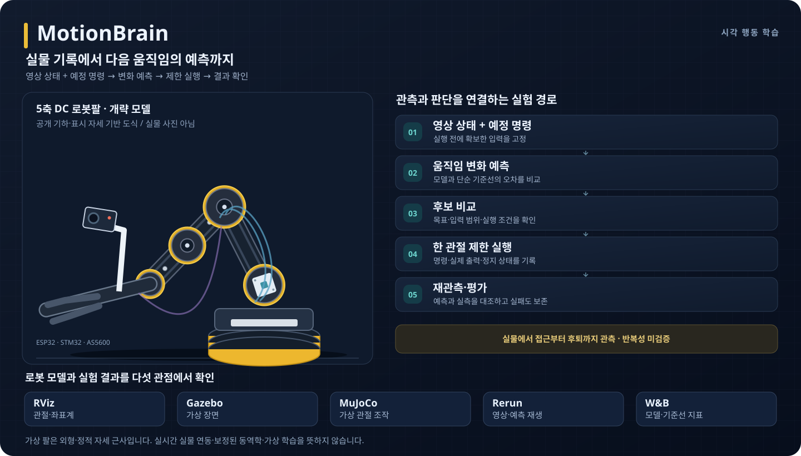
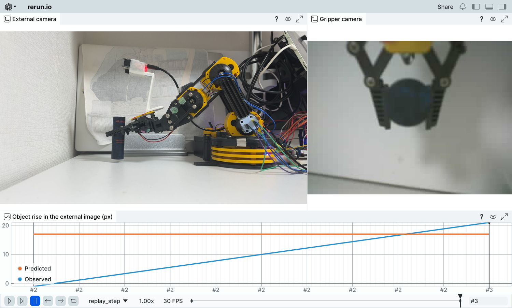

# MotionBrain

[English](README.en.md) · [포트폴리오](PORTFOLIO.md) · [실물 시험 영상 · 35.5초](docs/assets/whole-arm-cycle.mp4) · [빌드·운영](OPERATIONS.md) · [문서·실험 색인](docs/README.md)

**실물 로봇팔이 자기 행동의 결과를 학습하고, 그 예측으로 목표에 다가가게 하는 개인 피지컬 AI 프로젝트다.** 현재 팔과 물체의 모습에서 가능한 관절 명령들의 결과를 예측하고, 목표에 더 가까워질 동작을 고른다. 한 동작이 끝나면 실제로 무엇이 움직였는지 다시 관측해 다음 선택을 보정한다.

실험 플랫폼은 5축 DC 로봇팔 OWI-535다. 어깨에만 각도 센서가 있어 명령을 얼마나 오래 보냈는지만으로는 손목이 어디까지 움직였는지, 물체가 함께 들렸는지 알기 어렵다. 그래서 모터 제어 펌웨어, 두 카메라, 수집·학습 소프트웨어, ROS2 인터페이스를 직접 연결했다. 목표점에 한 번 접근하는 시험부터 물체를 집어 옮기는 시험까지 **예측이 실물의 목표 오차를 얼마나 줄였는가**를 평가한다.



## 실물 팔에서 호스트까지

| 구성 | 프로젝트에서 맡는 일 |
| --- | --- |
| **STM32·ESP32·모터 드라이버** | STM32 기본 펌웨어는 IMU 기울기와 버튼 입력을 이용해 UART로 원격조작 명령을 보낸다. 브라우저에서는 조이스틱과 관절 버튼으로 조작할 수 있다. ESP32가 TB6612FNG 드라이버 3개를 통해 다섯 모터의 방향·PWM·정지를 관리한다. 어깨(M4)는 AS5600 각도를 읽어 출력 차단 뒤의 관성 이동과 안정화까지 검사한다. [배선·센서](PIN_MAP.md) |
| **외부 카메라·ESP32-CAM** | 외부 영상에서 팔 전체와 물체의 이동을 보고, 집게 위 영상에서 턱과 물체의 상대 위치를 읽는다. 고정 구도에서 물체·집게 검출을 실험하고, 관절별 예측에는 표식·상대 좌표·물체 높이 등 해당 구도에서 검증한 관측값을 사용한다. [인식 실험](docs/evidence/2026-10-30-cv-development.md) |
| **Raspberry Pi·ROS2** | Pi가 인식·대시보드·ROS2 브리지를 제공한다. `ros2_control`의 M4 목표 제안을 작업자가 확인하면 실제 제어기가 센서 목표각으로 구동한다. 다른 네 축에는 직접 관절각 피드백이 없다. [ROS2 실물 인터페이스](ros2_ws/src/motionbrain_hardware_interface/README.md) |
| **호스트·학습 소프트웨어** | 영상, 원격조작 입력, 명령 수신과 실제 출력 이력을 함께 기록한다. 원본을 재생해 데이터셋을 만들고, 예측 모델과 기준선을 같은 표본에서 비교한다. [수집·재생](docs/manual-data-collection.md) · [학습 파이프라인](docs/experiment-pipeline.md) |

## 관측이 다음 행동이 되는 과정

1. **수집.** 한 관절의 제한된 동작 또는 사람의 전체 팔 원격조작을 기록한다. 누름부터 뗌까지의 한 행동에 유지 요청을 묶고, 실제 출력과 두 영상의 촬영 시점을 대조한다. 중단과 구동 전 실패도 남긴다.
2. **학습.** 실행 전 영상 특징·센서 상태와 예정 명령을 입력으로, 동작 뒤 관측한 변화를 정답으로 쓴다. 관절·자세·카메라 조건을 명시하고 모델을 고정한 뒤 새 자료에서 명령별 평균·무변화 기준선과 비교한다.
3. **선택·보정.** 학습한 범위 안에서 후보별 결과와 현재 목표의 차이를 비교한다. 고른 동작을 유한하게 실행하고 출력 정지와 사후 장면을 확인한 뒤 다음 후보를 고른다. 시연 기반 전체 팔 시험에서는 사람이 제공한 시연, 정책 선택, 규칙에 따른 단계 전환, 실제 모터 출력을 따로 기록했다.

[시각 행동 학습 설계](docs/visual-action-learning.md) · [모델 선택·순차 실행](docs/model-grasp-trial.md) · [논문과 설계 근거](docs/research/visual-action-learning.md)

## 무엇을 실물에서 확인했나

아래 수치는 각 실험의 질문에 대한 답이다. 센서 각도, 화면상의 위치 오차, 과제 완료 여부는 서로 다른 측정값이다.

| 질문 | 결과와 조건 |
| --- | --- |
| 목표각에 실제로 멈추는가? | M4 단독 폐루프 시험에서 230–245° 목표를 무하중 **11/11**, 23.10g 하중 **11/11** 도달했다. 센서 기준 평균 절대오차는 각각 **0.132°, 0.155°**였다. 별도의 ROS2 실물 시험에서는 목표 250.00°에 249.96°로 정지했다. [어깨 제어](docs/evidence/2026-06-28-m4-shoulder-closed-loop.md) · [ROS2 단일 목표](docs/evidence/2026-07-13-m4-physical-ros2-control.md) |
| 영상을 더하면 움직임 예측이 나아지는가? | M4 하향의 새 평가 18건에서 영상·명령 모델 오차는 **0.605°**, 명령 평균은 **0.367°**였다. M3 상대 상태 모델은 새 12건 중 두 방법이 모두 지원한 11건에서 **1.074px**, 명령 평균은 **1.341px**였다. M3는 하강 평가 수가 부족해 원래 통과 기준에 미달했다. [M4 평가](docs/evidence/2026-11-04-m4-action-prediction.md) · [M3 평가](docs/evidence/2026-11-12-m3-goal-prediction.md) |
| 모델의 선택으로 목표에 접근하는가? | M2가 선택한 한 동작으로 영상상 각도 오차가 **5.479°에서 0.967°**로 줄었다. 촬영 시작 4시도 중 3건은 구동 전에 중단했다. 이후 M3의 목표 접근과 M1의 닫기도 각각 다른 조건에서 실측했다. [M2 목표 접근](docs/evidence/2026-10-31-first-model-goal-approach.md) · [M3 접근](docs/evidence/2026-11-13-bounded-m3-approach.md) · [M1 닫기](docs/evidence/2026-11-13-model-selected-m1-close.md) |
| 여러 동작을 이어도 팔과 물체가 의도대로 움직이는가? | 준비된 장면에서 각 단계의 목표를 주면 모델이 그 안에서 동작을 선택해 파지·들기·내려놓기·해제를 연결했다. 후속 전체 팔 개발 5회차에서는 관절 버튼 입력 없이 접근부터 빈 팔 후퇴까지 관찰했다. 후퇴 종료각이 시연 하한에 **1.67°** 못 미쳐 당시 시험 판정은 실패였다. [단계별 모델 시험](docs/evidence/2026-11-15-prepared-scene-model-grasp-lift-release.md) · [전체 팔 개발 시험 5건](docs/whole-arm-cycle.md) |


[전체 팔 정책 실물 영상 · 35.5초](docs/assets/whole-arm-cycle.mp4) · [초기 유선 원격조작 시연](docs/assets/demo/motionbrain-demo.mp4)

## 기구학·시뮬레이션·평가 도구

실물 치수에서 공통 기하 모델을 만들고 FK·IK·URDF의 좌표를 대조한다. **RViz**에서 링크와 좌표계를 보고, **Gazebo·MuJoCo**에서 같은 기하의 가상 자세를 확인한다. 실물 영상에서는 두 시연의 첫 장면으로 등록한 뒤 나머지 8장에서 팔꿈치·손목·집게 끝의 평균 위치 오차가 각각 **1.56·4.72·46.58px**였다. 이 측정은 2차원 투영 오차다. 실물 동역학·접촉 보정과 시뮬레이션 정책의 실물 전이는 남아 있다. [기구학 측정](docs/arm-calibration.md)

| RViz | Gazebo | MuJoCo |
| --- | --- | --- |
| [](docs/assets/arm-rviz.png) | [](docs/assets/arm-gazebo.png) | [](docs/assets/arm-mujoco.png) |

**Rerun**은 저장된 외부·집게 영상과 예측·실측을 함께 재생한다. 별도 읽기 전용 화면에서는 두 카메라와 M4 센서의 최신 관측을 표시한다. **W&B**는 고정 모델과 기준선의 오차를 비교하는 데 쓴다. 모델을 바꾸면 어떤 조건에서 결과가 좋아졌는지 실패·평가 분모까지 추적할 수 있다. [실시간 미리보기](docs/live-observation.md) · [도구 실행 안내](docs/robot-visualization.md) · [공개 W&B 보고서가 있는 실험 기록](docs/evidence/2026-11-15-prepared-scene-model-grasp-lift-release.md#모델-비교-보고서)

| Rerun | W&B |
| --- | --- |
| [](docs/assets/arm-rerun.png) | [](docs/assets/arm-wandb.png) |

Rerun 장면은 어깨 UP 명령(50%, 500ms)에서 예측한 상승량 17px와 관측한 물체 상승량 21px를 보여준다. 별도 집게 실험의 W&B 보고서에서는 CLOSE 3회 동안 턱 사이 간격이 137.24px에서 49.70px로 줄었다. 그래프의 목표선은 35px다.

## 장치 없이 시작하기

호스트 검사에는 Python 3.12, NumPy, OpenCV, Node.js와 C++ 컴파일러가 필요하다. 선택적 PyTorch 검사는 설치된 의존성에 따라 건너뛴다. 펌웨어 빌드에는 PlatformIO를 사용한다.

합성 영상으로 집게 해제 시점을 검사해 볼 수 있다. 아래 테스트는 턱이 충분히 벌어졌는지, 물체가 탁상 기준 위치에 있는지, 두 카메라 모두 출력 확인 뒤의 새 관측을 제공했는지 확인한다.

```sh
python3 -m unittest discover -s tests -p 'test_whole_arm_release.py'
```

전체 호스트 검사와 펌웨어 빌드는 다음 명령으로 실행한다.

```sh
python3 -m unittest discover -s tests
pio run
pio run -d firmware/esp32cam
```

[운영 안내](OPERATIONS.md)에 환경별 설치·서비스·실물 실행 조건이 있다. 공개 저장소에서 코드 검사와 빌드를 재현할 수 있다. 원 실험의 수치를 다시 계산하려면 비공개 촬영 원본과 모델·구도 등록 자료가 필요하며, 전체 팔 실물 시험은 로컬 호스트 실행기도 사용했다. [PlatformIO CI](https://github.com/ParkJsoo/motionbrain/actions/workflows/platformio.yml) · [ROS2 CI](https://github.com/ParkJsoo/motionbrain/actions/workflows/ros2.yml)

## 다음 검증

작업 완료와 시연 자세 재현도를 별도로 평가하고, 같은 시작 조건에서 반복한 뒤 자세·물체·구도를 바꿔 목표 도달률과 보정 횟수를 비교한다. 저장 영상의 상태 판독과 시연 기반 행동 선택을 독립 에피소드에서 평가하고, 가상·실물 궤적의 차이도 측정할 예정이다. VLA·강화학습 정책과 Sim-to-Real 성능은 이후 비교할 연구 주제다.

## 라이선스

프로젝트 코드는 [MIT](LICENSE)를 따른다. STM32 HAL/CMSIS 외부 제공 파일은 `firmware/stm32/MotionBrainSensor/Drivers/`의 원래 라이선스를 따른다.
