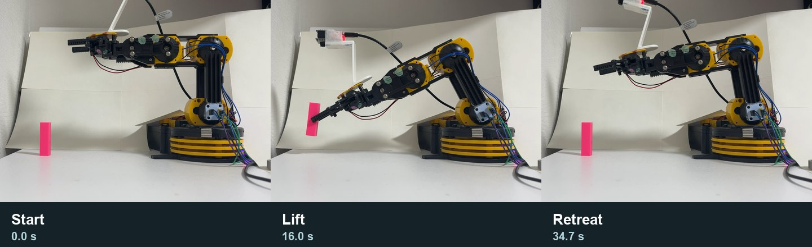

# 탁상 물체를 놓고 빈 팔이 물러나기까지

[프로젝트](../README.md) · [포트폴리오](../PORTFOLIO.md) · [시각 행동 학습](visual-action-learning.md) · [펌웨어 동작 조건](../OPERATIONS.md#전체-팔-모델-동작-시험)

분홍색 직육면체를 탁상에 세우고 빈 집게를 위쪽에 준비했다. 그 뒤 사람이 관절 버튼을 누르지 않은 상태에서 팔이 접근하고 물체를 집어 들었다가 내려놓고, 집게를 열고 물러났다. 다섯 번째 개발 시험에서 처음으로 이 여섯 단계의 실제 출력과 정지를 모두 확인했다. 당시 고정된 완료 조건으로는 실패였다.



[전체 시험 영상 (MP4, 35.5초)](assets/whole-arm-cycle.mp4)은 외부 카메라 133프레임을 실제 시간에 맞춰 재생한다. 단계 이름은 제어기의 동작 시작 기록을 기준으로 표시했다. 위 사진은 시작에서 약 0초, 16초, 34.7초 시점이다.

## 어떤 판단이 팔을 움직였나

사람은 물체와 시작 자세를 준비하고 원격조작 시연을 제공했다. 실행 중 호스트는 외부 카메라와 집게 위 카메라, 어깨(M4) 각도를 읽었다. 시연 영상과 현재 자세의 비교, 미리 정한 단계 순서, 영상 기하 조건이 함께 동작을 결정했다. 이번 접근은 같은 물체 배치에서 앞서 실제로 통과한 어깨 목표 219.63°를 사용했다. 펌웨어는 어깨와 집게를 **순차 구동**하고 출력·시간·각도 제한과 정지를 담당했다. 일반화 범위는 이 물체와 카메라 구도, 준비된 시작 자세에 한정된다.

| 5회차 관찰 | 판독 근거 |
| --- | --- |
| 잡고 들기 | 물체 하단이 외부 영상의 y=834에서 668까지 올라갔다. 실제 상승은 166px, 목표 상승은 226.25px였다. |
| 내려놓기 | 물체 하단이 처음 탁상 기준인 y=834로 돌아왔고 물체가 직립해 있었다. 영상만으로 탁상이 하중을 받기 시작한 순간을 알 수는 없다. |
| 집게 열기 | 집게 위 영상의 턱 사이 간격이 32.81px 늘었고 양쪽 턱이 물체 윤곽을 벗어났다. 영상 조건으로 OPEN을 멈춘 뒤 출력 OFF를 확인하고, 그 이후 촬영된 두 카메라 영상으로 해제를 다시 평가했다. |
| 빈 팔 후퇴 | 어깨가 실제로 올라갔고 정책은 214.98°에서 종료를 선택했다. 최종 각도 215.33°와 5축 출력 OFF를 확인했다. 마지막 영상에서 물체는 탁상에 직립해 있었다. |

## 무엇을 성공으로 셌나

기존 평가는 후퇴 종료를 선택한 각도가 수동 시연 종료각의 하한 216.65°에 이르는지도 검사했다. 5회차의 결정은 **1.67° 일렀고** 이 조건에서 실패했다. 이후 3초 동안 물체가 안정적이었는지는 관측하지 못했다.

저장 영상에서 물체 윗면과 집게 끝 아랫면 사이의 세로 간격을 다시 쟀다. 5회차 마지막 구간의 세 프레임에서는 **172 → 212 → 255px**로 벌어졌다. 마지막 간격은 그 영상 속 물체 높이의 **1.42배**였다. 수동 7·8·9회차 마지막 간격은 각각 **1.74·2.44·2.44배**였다. 이 값은 동일 영상 안의 물체를 자로 삼은 2차원 비교다. 실제 공간 거리와 별개이며, 정책이 이 비율을 계산해서 멈췄다고 해석할 근거도 없다.

| 전체 팔 개발 시험 | 실제 종료 지점 |
| --- | --- |
| 1회차 | 하강 후 제어기 상태 변화로 종료. 해제·후퇴 미실행 |
| 2·4회차 | 정책이 시작 전 정지 선택. 모터 시작 0회 |
| 3회차 | 하강 보정까지 완료. 집게 OPEN 시작 후 드라이버 오류로 종료 |
| 5회차 | 해제 후 새 영상 확인과 후퇴·정지까지 실행. 종료각 조건 미달 |

다섯 건은 개발 중 판단·펌웨어를 수정하며 수행했다. 세 건에서 모터가 시작됐고 두 건은 시작 전에 종료됐다. 고정 정책의 반복 성공률을 추정할 수 있는 자료는 아직 없다. 다음 평가에서는 **물체 직립·집게 이격·정지 후 안정성**으로 작업 완료를 판정하고 시연 종료 자세와의 차이 및 목표 높이 오차를 별도 측정한다. 새 기준을 도입해도 당시의 실패 기록은 유지한다.

## 공개 코드로 확인할 수 있는 범위

[접근 목표 선택](../learning/approach_exemplar.py), [해제 판정과 촬영 시각 검사](../learning/whole_arm_release.py), [제어기 단계·출력 처리](../src/control/whole_arm_service.cpp)를 함께 읽으면 영상 판정이 실제 출력과 만나는 경계를 볼 수 있다. 다음 검사는 장비 없이 공개 회귀 사례의 판정을 재현한다. 현장 실행에서는 같은 관측 계약의 두 카메라와 준비된 시작 배치, 비공개 시연 원본, 로컬 호스트 실행기를 함께 사용했다. 공개 저장소만으로 재현할 수 있는 범위는 위 구성 요소와 아래 회귀 검사까지다.

```sh
python3 -m unittest discover -s tests -p 'test_whole_arm_release.py'
python3 -m unittest discover -s tests -p 'test_approach_exemplar.py'
```
