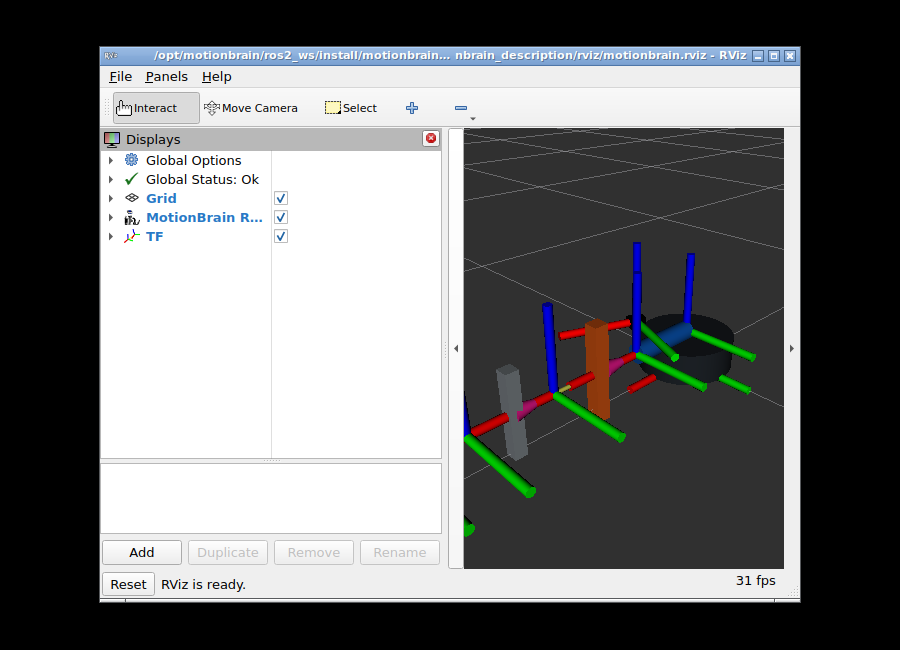

# ROS2 hardware interface

[한국어](README.md) · [Operations](../../../OPERATIONS.en.md)

`motionbrain_hardware_interface/MotionBrainHardwareInterface` is a `ros2_control` `SystemInterface` plugin. It separates estimated state, measured M4 feedback, and physical command proposals without assuming encoders on every joint.

## Modes

| `transport_mode` | Joints and interfaces | Behavior |
| --- | --- | --- |
| `dry_run` | Five position commands; position/velocity states | Open-loop state interpolation; no device communication |
| `m4_state` | Position/velocity state for `shoulder_pitch_joint` only | Subscribes to typed M4 feedback; no command interface |
| `m4_proposal` | M4 position command and state | Publishes typed proposals to a separate executor; no HTTP from the plugin |

The plugin implements lifecycle callbacks, finite-command checks, and command timeouts. Unsupported modes fail initialization. The five dry-run joints are `base_yaw_joint`, `shoulder_pitch_joint`, `elbow_pitch_joint`, `wrist_pitch_joint`, and `gripper_joint`.

The measured mode uses `status_topic=/motionbrain/status_typed` and `feedback_source=m4_as5600`. Calibration parameters are `shoulder_feedback_calibration_enabled`, `shoulder_sensor_zero_deg`, `shoulder_direction_sign`, and `shoulder_ros_joint_zero_rad`. `state_stale_timeout_sec` defaults to 2.0 seconds and must exceed the status bridge poll interval. Disabled calibration, stale feedback, or invalid feedback makes state unavailable; raw angles and open-loop estimates are not substitutes.

## Build and inspect

ROS2 Jazzy and the [CI dependencies](../../../.github/workflows/ros2.yml) are required. `--packages-up-to` also builds the message-package dependency.

```sh
cd ros2_ws
source /opt/ros/jazzy/setup.bash
colcon build --packages-up-to motionbrain_hardware_interface
source install/setup.bash
colcon test --packages-select motionbrain_hardware_interface
colcon test-result --verbose
ros2 launch motionbrain_hardware_interface hardware_interface.launch.py
```

Source the environment in a separate terminal before inspecting:

```sh
ros2 control list_hardware_interfaces
ros2 control list_controllers
ros2 topic echo /joint_states --once
```

The read-only measured mode is `m4_measured_state.launch.py`. Calibration is disabled by default. Enable it only after verifying the current mount zero and direction.

```sh
ros2 launch motionbrain_hardware_interface m4_measured_state.launch.py \
  shoulder_feedback_calibration_enabled:=true \
  shoulder_sensor_zero_deg:='<verified_zero_deg>' \
  shoulder_direction_sign:='<1_or_-1>'
```

## Physical execution boundary

`m4_proposal.launch.py` starts the proposal controller. `write()` does not POST to the ESP32; a separate M4 executor sends the legacy `/shoulder` command after operator confirmation. The default 20-second confirmation validity is not a motor run duration. `read()` does not call HTTP either.

Proposal IDs include a random producer session and sequence. The executor preserves consumed IDs and unknown outcomes in a persistent journal across restarts. This does not provide MCU deduplication or proof of physical completion. See the [journal/action contract (Korean)](../../../docs/data-pipeline.md) and [recovery procedure](../../../OPERATIONS.en.md#command-states-and-recovery).

Physical output passes through the ESP32 state machine, `SafetyGate`, token authentication, deadman/timeouts, and feedback checks. Host acceptance does not prove target convergence; output OFF does not prove electrical stop. Full-joint closed-loop trajectories and functional safety remain unverified.

The [2026-07-13 single-target M4 measurement](../../../docs/evidence/2026-07-13-m4-physical-ros2-control.en.md) is a limited validation of this path. It does not establish encoder-based control of the other four axes.



This URDF/RViz rendering is not evidence of physical tracking accuracy.
